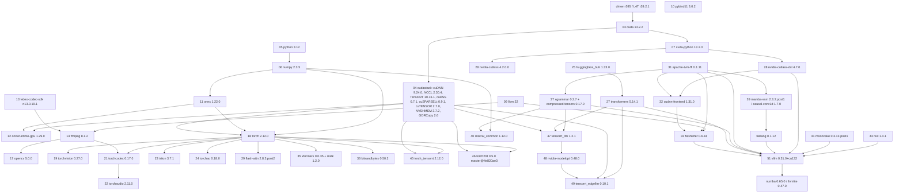

# Compatibilidade da cadeia `orin/build_image.sh` (Jetson AGX Orin)

Dispositivo: Jetson AGX Orin sm_87, JetPack 7.2 / L4T r39.2.1, driver r595, CUDA 13.2, Python 3.12, Ubuntu 24.04 aarch64.
Cadeia resolvida: 51 estágios. Execução de referência: `logs/20261109_162407` (última completa com 51 estágios). `logs/20261110_084804` é mais nova, mas parou no estágio 04 (cudastack, exit 1).
Dados coletados em 2026-11-10. Toda afirmação traz a evidência (arquivo:linha, commit, upstream@tag, PyPI, log). Quando um pin não tem motivo registrado, o documento diz isso.

---

## 1. Como usar e como regenerar

**Fluxo quando sai uma versão nova de X:**
1. Ache X na matriz (§3): veja a categoria, o que está acoplado e o primeiro estágio reconstruído.
2. Veja o grupo de acoplamento (§4) e a seção da lib (§5): motivo do pin, workarounds, checklist.
3. Confira os workarounds de X no índice (§6) e o teto do dispositivo (§7).
4. Rode um what-if (comando abaixo) antes de editar qualquer coisa.

**Legenda de categorias:** `hard-constraint` (imposto por driver/hardware), `compat-with-other-lib` (imposto por outra lib), `latest-at-the-time` (era a mais nova quando foi fixada; sem outro motivo), `no-recorded-reason` (nenhum motivo registrado), `workaround-required` (o pin existe para contornar um problema de empacotamento).

**Regenerar os dados** (todos são somente leitura no Docker; `docker run --rm`):

```bash
cd /home/jetson/Repositories/jetson-containers/orin

# Grafo instalado (Requires-Dist da imagem final), inteiro ou focado
./dep_graph.py [--image bedrock:r39.2.tegra-aarch64-cu132-24.04] [--json]
./dep_graph.py --focus numpy,transformers [--json]

# What-if: uv pip compile contra o devpi, com os pins de packages.txt como constraints
./dep_graph.py --what-if transformers==5.16.1 --json
./dep_graph.py --what-if vllm --what-if triton          # sem versão = mais nova do índice

# Auditoria das imagens de estágio: drift, flip-flops, uv pip check, locais ausentes no devpi
# (precisa do devpi no ar: build_image.sh --keep-running ou ../launch_pypi.sh)
./audit.py                                   # execução completa mais nova de logs/ (pula as incompletas e as --simulate: exige o .txt de cada estágio, audit.py:81-93)
./audit.py --log-dir ../logs/20261109_162407 -v   # -v lista todas as mudanças de versão

# Specs pip estáticos por estágio (antes de buildar); -v inclui INFO e a lista de libs por estágio
./lint.py -v                                 # equivale ao "--libs" (não existe flag --libs; ver print_libs, lint.py:723)
./lint.py -v vllm tensorrt_llm
./lint.py --packages outra_lista.txt         # lint.py, audit.py e dep_graph.py leem packages.txt por default

# Cadeia resolvida sem buildar
./build_image.sh --simulate
# Build real: no fim, sem --keep-running, roda ./clean.sh (modo default) e derruba devpi/APT (build_image.sh:204-213)
```

Observações sobre a evidência:
- `dep_graph.json` e `wi_*.json` citados abaixo são saídas do `orin/dep_graph.py` (ainda não versionado) gravadas em diretórios temporários (`/home/jetson/.claude/jobs/82288d94/tmp/`, `/tmp/`). Não são arquivos do repo. Os verificadores refizeram as afirmações de rdeps lendo os Requires-Dist da imagem final.
- Os what-ifs rodam só sobre metadados. `tensorrt-edgellm`, `mooncake-transfer-engine`, `tensorrt` e `torch2trt` aparecem como `local_not_resolved` e ficam fora da resolução.
- Contagens de logs de teste (`NN-1_*.txt`) incluem testes rodados contra a tag da imagem final, não só contra a tag do estágio.

---

## 2. Árvore de dependências

Seta `A --> B` = A depende de B (requisito pip, NEEDED do ELF ou `depends` do Dockerfile). O número é o estágio em `logs/20261109_162407`.



Versão texto (o que segura cada pin, só transitivos críticos):

```
driver r595 ── teto do CUDA 13.2 ── NCCL ≤2.30.4 (+cuda13.2), TensorRT 11 só 11.0.0 p/ cuda13.2, nv-codec-headers ≤ n13.0.x
python 3.12 ── todos os wheels locais cp312; mistral-common usa numpy<2.4 em py≤3.12
numpy 2.3.5 ── teto mistral-common <2.4, piso tensorrt-edgellm >=2.2.6, numba 0.65 <2.5
torch 2.12.0 ── torchvision 0.27.0 (==2.12.0 no PyPI), torch_tensorrt 2.12 (<2.13), triton 3.7.x (convenção upstream), libtorch extensions
transformers 5.14.1 ── tensorrt-llm ==5.14.1 (gerado pelo nosso sed), vllm 0.31 <5.18
nvidia-cutlass-dsl 4.7.0 ── vllm (==, via sed), cudnn-frontend 1.31.0 (1.32 exige >=4.8); Edge-LLM usa o prebuilt CuTe DSL do upstream, não o pacote
apache-tvm-ffi 0.1.11 ── vllm ==0.1.11, tilelang 0.1.12 ≤0.1.11, tokenspeed-mla ≤0.1.11, cudnn-frontend >=0.1.11
vllm 0.31.0 ── numba ==0.65.0, compressed-tensors ==0.17.0, tilelang ==0.1.12, apache-tvm-ffi ==0.1.11
```

---

## 3. Matriz de compatibilidade

| lib | pin | mais nova upstream | origem | categoria | acoplada com | 1º estágio |
|---|---|---|---|---|---|---|
| CUDA Toolkit | 13.2.2 | 13.5.0 (13.2.x: 13.2.2) | apt local installer NVIDIA | hard-constraint | driver r595, índice cu132, NCCL, TRT, cuda-python, mslk | 03 |
| cuDNN | 9.24.0 | 9.28.1 | apt local installer | no-recorded-reason | torch, opencv, onnxruntime, mslk, cudnn-frontend | 04 |
| NCCL | 2.30.4 | 2.32.3 | apt sbsa (+cuda13.2) | hard-constraint (inferido) | CUDA 13.2, mslk | 04 |
| TensorRT | 10.16.1 | 11.4.0.106 (10.x: 10.16.1) | tarball NVIDIA | latest-at-the-time | torch_tensorrt (<10.17), ORT, TRT-LLM, torch2trt, Edge-LLM | 04 |
| cuDSS | 0.7.1 (imagem atual: 1.0.0.35) | 1.0.0.35 | apt sbsa | latest-at-the-time | test_cudss.sh (soname 0) | 04 |
| cuSPARSELt | 0.9.1 | 0.10.0 | apt sbsa | latest-at-the-time | nenhum consumidor | 04 |
| cuTENSOR | 2.7.0 | 2.8.1 | apt local installer | latest-at-the-time | nenhum consumidor | 04 |
| NVSHMEM | 3.7.2 | 3.8.0 | apt local installer | latest-at-the-time | nenhum consumidor | 04 |
| GDRCopy | 2.6 | 2.6 | tarpack local | latest-at-the-time | nenhum consumidor | 04 |
| python | 3.12 (3.12.16) | 3.15.2 (3.12.x: 3.12.16) | uv python-build-standalone | no-recorded-reason | todos os wheels cp312, numpy (via mistral-common) | 05 |
| numpy | 2.3.5 | 2.5.4 | PyPI via devpi | compat-with-other-lib | mistral-common, numba, tensorrt-edgellm, tensorrt-llm | 06 |
| cuda-python | 13.2.0 | 13.5.0 | PyPI via devpi | compat-with-other-lib | cuda 13.2 (convenção) | 07 |
| llvm | 22 (22.1.8) | 23.1.5 | apt.llvm.org | compat-with-other-lib | ffmpeg, flashinfer, vulkan (depends llvm:22) | 09 |
| pybind11 | 3.0.2 | 3.1.0 | PyPI via devpi | latest-at-the-time | triton, torchcodec (build); Edge-LLM só no depends (builda com 3.0.4 da venv própria) | 10 |
| onnx | 1.22.0 | 1.23.2 | PyPI via devpi | compat-with-other-lib | onnxruntime (vendored v1.22.0) | 11 |
| onnxruntime-gpu | 1.29.0 | 1.31.1 | build local (blacklist) | latest-at-the-time | onnx, TensorRT, cuDNN | 12 |
| video-codec-sdk | n13.0.19.1 | n13.1.15.0 | git tag | hard-constraint | driver r595, ffmpeg, opencv, torchcodec | 13 |
| ffmpeg | 8.1.2 | 9.0.2 / 8.1.3 | tarball → tarpack | compat-with-other-lib | opencv, torchcodec (soname 62), video-codec-sdk | 14 |
| libaom | v3.15.2 | v3.15.3 | git tag + SHA | latest-at-the-time | ffmpeg | 14 |
| SVT-AV1 | v2.3.0 | v4.3.0 | git tag | compat-with-other-lib (motivo obsoleto) | ffmpeg | 14 |
| opencv | 5.0.0 | 5.1.0 | build local (blacklist) + tarpack | latest-at-the-time | ffmpeg (avcodec 62), cuDNN 9, numpy>=2 | 17 |
| torch | 2.12.0 | 2.15.0 | build local (blacklist) | no-recorded-reason | torchvision, torch_tensorrt, triton, extensões libtorch | 18 |
| torchvision | 0.27.0 | 0.29.2 | build local | compat-with-other-lib | torch 2.12.0 | 19 |
| pyav (av) | sem pin (19.0.2) | 19.0.2 | PyPI via devpi | no-recorded-reason | nenhum (FFmpeg próprio no wheel) | 20 |
| torchcodec | 0.17.0 | 0.17.0 | build local | compat-with-other-lib | vllm (>=0.14), ffmpeg 8.1.2 | 21 |
| torchaudio | 2.11.0 | 2.11.1 | build local | no-recorded-reason | torch | 22 |
| triton | 3.7.1 | 3.9.0 | PyPI via devpi | compat-with-other-lib | torch 2.12 (convenção), TRT-LLM | 23 |
| torchao | 0.18.0 | 0.18.0 | build local (blacklist) | latest-at-the-time | torch (>=2.11 em runtime) | 24 |
| huggingface_hub | sem pin (1.33.0) | 2.4.0 | PyPI via devpi | compat-with-other-lib | transformers <2.0 | 25 (fixado em 27) |
| transformers | 5.14.1 | 5.22.2 | PyPI via devpi | compat-with-other-lib | tensorrt-llm, Edge-LLM, vllm <5.18 | 27 |
| nvidia-cutlass | 4.2.0 (4.2.0.0) | 4.2.0.0 | PyPI via devpi | workaround-required | nenhum consumidor declarado | 28 |
| nvidia-cutlass-dsl | 4.7.0 | 4.8.1 | PyPI via devpi | compat-with-other-lib | vllm, cudnn-frontend, flashinfer (Edge-LLM não consome mais) | 28 |
| flash-attn | 2.8.3.post2 | 2.8.3.post2 | build local (blacklist) | no-recorded-reason | torch | 29 |
| apache-tvm-ffi | 0.1.11 | 0.1.15.post2 | PyPI via devpi | compat-with-other-lib | vllm ==, tilelang ≤, tokenspeed-mla ≤, cudnn-frontend >= | 31 |
| cudnn-frontend | 1.31.0 | 1.32.2 | PyPI via devpi | latest-at-the-time | DSL (<4.8), flashinfer | 32 |
| flashinfer | 0.6.18 | 0.7.3 | build local (blacklist) | no-recorded-reason | cudnn-frontend, DSL, tvm-ffi, vllm | 33 |
| diffusers | 0.40.0 | 0.42.1 | PyPI via devpi | latest-at-the-time | nenhuma | 34 |
| xformers | 0.0.35 | 0.0.35 | build local (blacklist) | latest-at-the-time | torch, mslk | 35 |
| mslk | 1.2.0+cu132 | 1.3.0+cu132 | wheel do whl/cu132 espelhado no devpi (blacklist) | compat-with-other-lib | torch 2.12, CUDA 13.2, NCCL do sistema | 35 |
| bitsandbytes | 0.50.2 | 0.50.2 | build local (blacklist) | latest-at-the-time | torch <3 | 36 |
| xgrammar | 0.2.7 | 0.2.9 | build local (blacklist) | no-recorded-reason | vllm, TRT-LLM (cópia embutida 0.1.32) | 37 |
| compressed-tensors | 0.17.0 | 0.20.1 | PyPI via devpi | compat-with-other-lib | vllm ==0.17.0 | 37 |
| causal-conv1d | 1.7.0 | 1.7.0 | build local (blacklist) | latest-at-the-time | mamba | 38 |
| mamba-ssm | 2.3.2.post1 | 2.3.2.post1 | build local (blacklist) | latest-at-the-time | tilelang, tvm-ffi (pins removidos) | 39 |
| tilelang | 0.1.12 (sem estágio) | 0.1.15 | PyPI via devpi | compat-with-other-lib | vllm ==0.1.12, tvm-ffi | 39 / 51 |
| mistral_common | 1.12.0 | 1.13.1 | PyPI via devpi | compat-with-other-lib | transformers, vllm, numpy <2.4 | 40 |
| mooncake | 0.3.13.post1 | 0.3.14 | sempre compila (blacklist) | latest-at-the-time | vllm (>=0.3.12, só upstream) | 41 |
| nixl | 1.4.1 | 1.5.2 | PyPI via devpi | compat-with-other-lib | vllm (==1.4.1, só upstream) | 43 |
| torch_tensorrt | 2.12.0 (v2.12.0) | 2.14.0 (2.12.x: 2.12.1) | build local (blacklist) | compat-with-other-lib | torch <2.13, TensorRT >=10.16.1,<10.17 | 45 |
| torch2trt | 0.5.0 (master @4e820ae3) | sem release após v0.5.0 | sempre compila do fonte | workaround-required | TensorRT 10 (libnvinfer.so.10), torch | 46 |
| tensorrt_llm | 1.2.1 | 1.2.1 estável (pré: 1.4.0rc3) | build local (blacklist) | compat-with-other-lib | transformers ==5.14.1 (sed), TensorRT 10, xgrammar (cópia 0.1.32), modelopt | 47 |
| nvidia_modelopt | 0.48.0 | 0.48.0 | PyPI via devpi | latest-at-the-time | TRT-LLM (`~=0.37.0` no METADATA, não satisfeito), Edge-LLM (depends) | 48 |
| tensorrt_edgellm | 0.10.1 | 0.11.1 | build local (wheel com payload nativo + tarpack) | no-recorded-reason | CuTe DSL prebuilt do upstream (4.7.0), TensorRT 10, numpy >=2.2.6 | 49 |
| torch-memory-saver | 0.0.10 | 0.0.10 | PyPI via devpi | latest-at-the-time | nenhuma | 50 |
| vllm | 0.31.0+cu132 | 0.33.0 | build local (blacklist) | latest-at-the-time | transformers, xgrammar, DSL, tvm-ffi, numba, compressed-tensors, tilelang | 51 |
| numba | 0.65.0 (sem pin no repo) | 0.68.1 | PyPI via devpi | compat-with-other-lib | vllm ==0.65.0, numpy <2.5 | 49 / 51 |
| llvmlite | 0.47.0 (sem pin no repo) | 0.50.0 | PyPI via devpi | compat-with-other-lib | numba 0.65.0 | 49 / 51 |

Estágios da cadeia sem linha na matriz (não estão em `PACKAGES`; ferramentas de build): cmake (08), opengl (15), vulkan (16), rust (26), ninja (30), go (42), bazel (44). go fixa `GOLANG_VERSION="1.22.7"` (`packages/build/go/Dockerfile:11`); ninja e bazelisk baixam a release mais nova no momento do build (`build/ninja/Dockerfile:15`, `build/bazel/Dockerfile:13`), ou seja, não são reprodutíveis. Não foram auditados além disso.

---

## 4. Grupos de acoplamento

| grupo | membros | por que andam juntos | evidência |
|---|---|---|---|
| G1 driver/CUDA | driver r595, CUDA 13.2, índice `jp7/cu132`, NCCL +cuda13.2, tarball TRT `cuda-13.2`, cuda-python 13.2, mslk `whl/cu132`, nv-codec-headers | O minor do CUDA vem do driver do L4T. Mudar o minor troca o caminho do índice e os builds amarrados a 13.2. | cuda-compat-13-2=595.x, 13-3=610.x (sbsa Packages.gz); `packages/cuda/cuda/config.py:139-151`; cuDriverGetVersion()=13020 |
| G2 ABI do torch | torch 2.12.0, torchvision 0.27.0, torchaudio 2.11.0, torchcodec 0.17.0, torchao 0.18.0, torch_tensorrt 2.12.0, flash-attn, xformers, bitsandbytes, mamba, causal-conv1d, flashinfer-jit-cache, mslk, vllm | Extensões compiladas contra a libtorch da imagem (`--no-build-isolation`). torchvision 0.27.0 do PyPI exige torch==2.12.0. torch_tensorrt exige torch<2.13.0. mslk 1.2.0 foi descrito como "a release que casa com PyTorch 2.12 e CUDA 13.2". | PyPI torchvision 0.27.0; image metadata torch_tensorrt; bad4b4bc. Estágios que linkam libtorch: inferido, não verificado (pytorch §5) |
| G3 torch ↔ triton | torch 2.12, triton 3.7.x | Upstream pareia 2.12 com triton 3.7.0. `config.py:31` só libera 3.8.0 para torch>=2.13. O torch local não declara triton. | pytorch@v2.12.0 `.ci/docker/triton_version.txt`; 4f9327d6 |
| G4 transformers | transformers 5.14.1, tensorrt-llm 1.2.1, tensorrt_edgellm 0.10.1, vllm 0.31.0, tokenizers, huggingface_hub | TRT-LLM recebe `==${TRANSFORMERS_VERSION}` no wheel (`tensorrt_llm/build.sh:27`). vllm 0.31 exige <5.18.0. vllm >=0.32 exige >=5.16.1. Edge-LLM upstream exige ==5.14.1 (relaxado pelo nosso sed). transformers 5.14–5.17 exige huggingface-hub<2.0. nvidia-modelopt 0.47.0 pede `transformers<5.15,>=4.57` só no extra `[hf]` (não instalado); 0.48.0 pede `<5.19,>=5.5`. | e0bfb45b; PyPI vllm; Edge-LLM v0.10.1 requirements.txt:2; PyPI nvidia-modelopt 0.47.0/0.48.0 requires_dist |
| G5 CuTe DSL | nvidia-cutlass-dsl 4.7.0 (`cutlass/version.py:4`, lido por `cutlass/config.py:15` e `vllm/config.py:23`), vllm (wheel), nvidia-cudnn-frontend 1.31.0, flashinfer, quack-kernels, protobuf <7 | O wheel do vllm grava `==${CUTLASS_DSL_VERSION}` (4.7.0) via sed. cudnn-frontend 1.32 exige >=4.8.0. flashinfer 0.7.3 exige cudnn-frontend >=1.32 e DSL >=4.8.0. O tensorrt_edgellm saiu do grupo (não commitado): o build não instala o DSL nem lê `CUTLASS_DSL_VERSION`; usa o tarball CuTe DSL prebuilt que o upstream versiona por tag (gerado com 4.7.0). | `vllm/build.sh:27`; `tensorrt_edgellm/config.py` e `Dockerfile` sem `CUTLASS_DSL_VERSION`; wi2_nvidia-cudnn-frontend==1.32.2 |
| G6 apache-tvm-ffi | apache-tvm-ffi 0.1.11, vllm, tilelang 0.1.12, tokenspeed-mla 0.1.8, cudnn-frontend 1.31.0, xgrammar, flashinfer, mamba | vllm exige ==0.1.11; tilelang e tokenspeed-mla ≤0.1.11; cudnn-frontend >=0.1.11. | bc2a90ee; wi2_apache-tvm-ffi==0.1.15.post2 |
| G7 xgrammar | xgrammar 0.2.7 (wheel local), cópia 0.1.32 dentro de `libtensorrt_llm.so`, vllm | Os dois coexistem só por causa do link `-Wl,-Bsymbolic` (sem ele: GrammarMatcher "not optimized" ou segfault com tensorrt_llm carregado). | 4dca04a4; `xgrammar/build.sh:17-19` |
| G8 numpy | numpy 2.3.5, mistral-common 1.12.0 (<2.4 em py≤3.12), numba 0.65.0 (<2.5), tensorrt-edgellm (>=2.2.6), tensorrt-llm (<2, sobrescrito), python 3.12 | Só a faixa 2.3.x satisfaz todos. | 914f38a3; `numpy/config.py:8-10` |
| G9 vllm pins exatos | vllm 0.31.0, numba 0.65.0 + llvmlite 0.47.0, compressed-tensors 0.17.0, tilelang 0.1.12 | São mantidos no METADATA do wheel local. numba ==0.65.0 vale para vllm 0.28.0 até 0.33.0. | METADATA na imagem final; PyPI JSON |
| G10 FFmpeg soname | ffmpeg 8.1.2 (libavcodec.so.62), opencv 5.0.0, torchcodec 0.17.0 (core8), torchaudio, video-codec-sdk, libaom, SVT-AV1 | cv2 e libtorchcodec_core8 linkam libavcodec.so.62. FFmpeg 9.x muda para .so.63 e força rebuild (não reinstalação) de opencv e torchcodec. | ldd na imagem final; version_major.h@n8.1.2/@n9.0.2 |
| G11 TensorRT | TensorRT 10.16.1, torch_tensorrt 2.12.0, onnxruntime, tensorrt_llm, torch2trt, tensorrt_edgellm | Todos precisam de libnvinfer.so.10. torch_tensorrt 2.12 exige >=10.16.1,<10.17.0. TRT 11 muda o soname. torch_tensorrt 2.13.0 já exige `tensorrt>=11.0.0,<11.1.0` e `torch>=2.13.0,<2.14.0`, então os dois andam juntos. | setup.py@v2.12.0:826,846; PyPI torch-tensorrt 2.13.0 requires_dist; readelf (libtensorrt_llm.so NEEDED libnvinfer.so.10) |
| G12 onnx ↔ ORT | onnx 1.22.0, onnxruntime 1.29.0 | O ORT embute e testa onnx v1.22.0 (o ORT 1.31.1 também). | deps.txt@v1.29.0; submódulo 2bb50465 |

---

## 5. Seções por lib

Formato: **Pin** · **Origem** · **Requisitos upstream** · **Requerida por** · **Restrições** · **Workarounds** · **Histórico** · **Testado** · **Motivo** · **Checklist de upgrade**.

### 5.1 CUDA Toolkit — `packages/cuda/cuda`
- **Pin:** 13.2.2 (cuda-toolkit-13-2 13.2.2-1, nvcc V13.2.86). `orin/packages.txt:4` usa `cuda` sem versão; o alias vale quando `Version(version)==CUDA_VERSION` (`config.py:56-57`). URL em `config.py:222-224`. O comentário `# 13.2.1` em `orin/packages.txt:4` está errado desde que foi criado (cafce683).
- **Origem:** `cuda-repo-ubuntu2404-13-2-local_13.2.2-595.71.05-1_arm64.deb` (CUDA_URL nos 21 `logs/*/build/*cuda_13.2.sh`).
- **Requerida por:** todos os estágios seguintes. Exemplos: cudastack `config.py:175`; cuda-python (`cuda-python/config.py:26-33`); `install_nccl.sh:6-12`, `install_cudss.sh:6-12` e `install_cusparselt.sh:18-24` escolhem o repo sbsa porque CUDA>=132.
- **Restrições:** driver host r595 (NVRM r595_00, nvidia-l4t-core 39.2.1). sbsa: cuda-compat 13-3=610.x, 13-4=615.x, 13-5=620.70.06.
- **Workarounds:** nenhum específico.
- **Histórico:** 9ac3274e, 4626a485, 93b3f8be (upstream); a23bce5d; 06f3e29b 2026-08-28 (13.2.1 → 13.2.2, ubuntu2404, sem motivo); cafce683 2026-09-25 (comentário).
- **Testado:** só 13.2.2. `logs/20261021_123520` terminou com exit 0.
- **Motivo:** `hard-constraint`. O minor é fixado pelo driver r595. 13.2.2 é o patch mais novo do 13.2; 06f3e29b não dá motivo para a escolha. O master upstream continua com a URL 13.2.1 ubuntu2204 (595.58.03).
- **Checklist:** um bump de patch 13.2.x mexe só em `config.py:223`. Isso reconstrói 03 e 04–51, e os estágios seguintes reinstalam do devpi/tarpack (em 20261109_162407 só mooncake 41 e torch2trt 46 compilaram). Ir para 13.3+ está bloqueado pelo driver; também mudaria o índice para cu133 e os pins amarrados a 13.2 (NCCL, tarball TRT, cuda-python, mslk). Corrigir o comentário em `orin/packages.txt:4`.

### 5.2 cuDNN — `packages/cuda/cudastack`
- **Pin:** 9.24.0 (libcudnn9-cuda-13 9.24.0.43-1). `cudastack/config.py:24-26`. Na imagem, `torch.backends.cudnn.version()=92400`.
- **Origem:** `cudnn-local-repo-ubuntu2404-9.24.0` (`config.py:25`), instalado por `install/install_cudnn.sh:10-22`.
- **Requisitos upstream:** `Depends: zlib1g` (sbsa).
- **Requerida por:** com NEEDED direto de libcudnn.so.9: torch, cv2, onnxruntime (+ `libonnxruntime_providers_tensorrt.so`), mslk.so. As demais libs só chegam a ela pela libtorch. nvidia-cudnn-frontend 1.31.0 é exigido por flashinfer (>=1.25.0) e vllm (>=1.19.1).
- **Restrições:** nenhuma encontrada.
- **Workarounds:** `tensorrt_llm/install.sh:50` remove `nvidia-cudnn.*` dos requirements do TRT-LLM.
- **Histórico:** 9ac3274e (9.20.0); 51450b39 (9.21.1, upstream); 06f3e29b 2026-08-28 (9.21.1 → 9.24.0, sem motivo).
- **Testado:** só 9.24.0. "cuDNN passed" em `logs/20261109_162407/test/04-1`.
- **Motivo:** `no-recorded-reason`. 9.24.0 nem era a mais nova no dia: 9.25.0.15 saiu em 2026-07-20 e 9.25.1.1 em 2026-08-28. Também existe o patch 9.24.1.1 (2026-09-01).
- **Checklist:** editar `config.py:24-25` reconstrói 04 e 05–51. Os wheels de devpi/tarpack (torch, opencv, ORT) não são recompilados; o soname .so.9 continua o mesmo. Retestar esses wheels e o par com cudnn-frontend 1.31.0 (dd126b22).

### 5.3 NCCL — `packages/cuda/cudastack`
- **Pin:** 2.30.4 (libnccl2 2.30.4-1+cuda13.2). `config.py:29-30`.
- **Origem:** repo sbsa via cuda-keyring (`install_nccl.sh:21-31`), versão `${NCCL_VERSION}-1+cuda${CUDA_VER}` (`:14-17`). Fallback `build/build_nccl.sh` (tag v2.30.4-1, sm_87). `NCCL_URL` (`config.py:30`, Dockerfile:23) não é usado.
- **Requerida por:** `mslk/mslk.so` tem NEEDED libnccl.so.2, resolvido para a lib do sistema. O torch usa a NCCL embutida (2,29,7); `pytorch/build.sh:48-51` só põe USE_SYSTEM_NCCL=1 se `ENABLE_DISTRIBUTED_JETSON_NCCL=1`. A pip nvidia-nccl-cu13 2.28.9 também está instalada (tensorrt_llm `<=2.28.9,>=2.27.7`, `requirements.txt@v1.2.1:29`; nccl4py). cuDSS traz `libcudss_commlayer_nccl.so`.
- **Restrições:** no sbsa, a libnccl2 +cuda13.2 mais nova é a 2.30.4 (2.30.7 já é +cuda13.3). O redist 2.31.2 +cuda13.2 dá 404.
- **Workarounds:** `build_nccl.sh:19-25` só aplica patches quando `ENABLE_DISTRIBUTED_JETSON_NCCL=1` (há patches só para 2.27.7/2.28.7/2.29.3; o flag é 0 nesta cadeia); `install_nccl.sh:33-38` faz purge do cuda-keyring.
- **Histórico:** 7516a0f5, cf8efcfd, 3fc65a09, c960e53b (upstream); 06f3e29b (2.29.7 → 2.30.4, sem motivo).
- **Testado:** só 2.30.4. "NCCL passed" (o teste distribuído foi pulado).
- **Motivo:** `hard-constraint`, mas inferido da evidência, não declarado em lugar nenhum. 2.30.4 era o build +cuda13.2 mais novo, não a release mais nova.
- **Checklist:** acima de 2.30.4 é preciso CUDA 13.3+ (bloqueado) ou o caminho de build `build_nccl.sh`. Reconstrói 04–51. Retestar mslk/xformers (35). Remover o arg `NCCL_URL`, que não é usado.

### 5.4 TensorRT — `packages/cuda/cudastack`
- **Pin:** 10.16.1 (tarball `TensorRT-10.16.1.11.Linux.aarch64-gnu.cuda-13.2`). `config.py:27-28`.
- **Origem:** `install_tensorrt.sh:46-107` extrai em `/usr/local/cuda/targets/aarch64-linux/lib`; os wheels python são copiados nas linhas 81-87.
- **Requisitos upstream:** tensorrt-llm 1.2.1 pede `tensorrt~=10.14.1` (`requirements.txt:22`), que não é satisfeito; o sed remove a linha.
- **Requerida por:** torch_tensorrt 2.12.0 (`>=10.16.1,<10.17.0`), tensorrt_llm 1.2.1, onnxruntime (`onnxruntime/build.sh:8-20,135`), torch2trt, tensorrt_edgellm. Nenhuma dist declara Requires-Dist em tensorrt.
- **Restrições:** NEEDED libnvinfer.so.10 em ORT, torch_tensorrt, tensorrt_llm e torch2trt. No sbsa, o único TRT 11 para +cuda13.2 é o 11.0.0.114.
- **Workarounds:** `tensorrt_llm/install.sh:41`; `torch_tensorrt/build.sh:28,36`; `install_tensorrt.sh:100-103` (9bdd29e6).
- **Histórico:** 0bee4489, d32ce077 2026-04-13 (10.16.1, upstream); 06f3e29b (sem mudança); 9bdd29e6.
- **Testado:** só 10.16.1. O teste só imprime a versão: o trtexec não existe (`test/04-1_*.txt:53`) e mesmo assim sai "TensorRT passed".
- **Motivo:** `latest-at-the-time` (upstream d32ce077). Nada registra por que o fork continua no 10.x. Hoje o pin também é exigido pelo torch_tensorrt.
- **Checklist:** não existe 10.x mais novo. TRT 11 muda o soname e quebra o `<10.17` do torch_tensorrt 2.12. Exigiria rebuild com FORCE_BUILD de ORT (12), torch_tensorrt (45, precisa de release upstream nova), torch2trt (46), tensorrt_llm (47) e Edge-LLM (49). Revisar os seds. Com CUDA 13.2 só existe o 11.0.0.

### 5.5 cuDSS — `packages/cuda/cudastack`
- **Pin:** 0.7.1 (`config.py:118`), imposto por `install_cudss.sh:22-39` (994f352d). **A imagem final atual tem 1.0.0.35** (CUDA 12 e 13), cudss0 0.8.0-1 e o meta cudss 0.7.1-1, porque 994f352d ainda não foi buildado.
- **Origem:** repo sbsa. Depois de 994f352d: cudss-cuda-13 + libcudss0{,-dev,-static}-cuda-13 no prefixo `0.7.1.` (só existe 0.7.1.4-1), sem o meta.
- **Requerida por:** nenhum pacote da cadeia (`pytorch/build.sh:97` USE_CUDSS=0; nenhum NEEDED).
- **Restrições:** `test_cudss.sh:24` exige libcudss.so.0.
- **Histórico:** 17f93f9d 2025-10-28 (0.7.1, upstream); 994f352d 2026-11-10.
- **Testado:** `logs/20261109_162407`: 1.0.0.35 instalado, "CUDSS failed" (`test/04-1_*.txt:72-74`). `logs/20261110_084804`: estágio 04 em CACHED, mesma falha.
- **Motivo:** `latest-at-the-time` (upstream). Não há registro de por que 0.7.1 e não 0.8.0.
- **Checklist:** reconstruir 04 para tirar o 1.0 da imagem. 0.8.x mantém o soname 0; 1.x exige atualizar `test_cudss.sh:24`. Nada a recompilar depois.

### 5.6 cuSPARSELt — `packages/cuda/cudastack`
- **Pin:** 0.9.1 (`config.py:95-98`). sbsa, `install_cusparselt.sh:16-59`.
- **Requerida por:** nenhum consumidor em runtime. `torch.backends.cusparselt.version()=None`, embora `pytorch/build.sh:96` exporte USE_CUSPARSELT=1. Não há entrada no `ldconfig -p`.
- **Workarounds:** `pytorch/build.sh:30-44` faz symlink de um `libcusparseLt.so.0.8.0.4` fixo no código, que não existe (está obsoleto). `install_cusparselt.sh:48-51` cai em silêncio para a versão mais nova.
- **Histórico:** 0fc4c992 (upstream); 06f3e29b (0.9.0 → 0.9.1, sem motivo).
- **Testado:** 0.9.1, "cuSPARSELt passed", SASS sm_87 (`test/04-1_*.txt:97,105`).
- **Motivo:** `latest-at-the-time`.
- **Checklist:** reconstrói 04–51. Para o torch usar a lib: corrigir `pytorch/build.sh:31-38` e rodar FORCE_BUILD do pytorch (18). Fazer a instalação falhar em vez de cair para a mais nova.

### 5.7 cuTENSOR — `packages/cuda/cudastack`
- **Pin:** 2.7.0 (`config.py:120`). Local repo (`install_cutensor.sh:15-25`), instala `cutensor-cuda-13` sem versão.
- **Requerida por:** nenhuma dist (sem NEEDED).
- **Testado:** nunca. O teste está comentado (`cudastack/test.sh:72-75`).
- **Motivo:** `latest-at-the-time` (06f3e29b, 2.6.0 → 2.7.0).
- **Checklist:** reconstrói 04–51. Reativar o teste antes de depender da lib.

### 5.8 NVSHMEM — `packages/cuda/cudastack`
- **Pin:** 3.7.2 (`config.py:123`). Local repo (`install_nvshmem.sh:6-12`).
- **Requerida por:** nenhuma dist. `flashinfer/build.sh:25-27` usa a pip nvidia-nvshmem-cu13 quando builda.
- **Testado:** `test_nvshmem.sh:3-5` é placeholder e sempre passa.
- **Motivo:** `latest-at-the-time` (06f3e29b).
- **Checklist:** reconstrói 04–51.

### 5.9 GDRCopy — `packages/cuda/cudastack`
- **Pin:** 2.6 (`config.py:121`). Tarpack `gdrcopy-2.6.tar.gz`. O fallback `build_gdrcopy.sh:17` clona master sem tag.
- **Requerida por:** ninguém.
- **Workarounds/bugs:** `build_gdrcopy.sh:21` remove a dependência gdrdrv-dkms. **Bug:** o tarball contém `./usr/...` e é extraído com `-C /usr/local`, então a lib cai em `/usr/local/usr/lib/aarch64-linux-gnu/libgdrapi.so.2.6` e não aparece no ldconfig.
- **Testado:** `test_gdrcopy.sh` só tem o shebang ("Skipping empty test").
- **Motivo:** `latest-at-the-time` (06f3e29b; v2.6 de 2026-06-13 ainda é a tag mais nova).
- **Checklist:** corrigir o layout do tarball e o clone sem tag antes de depender da lib.

### 5.10 cuda-python — `packages/cuda/cuda-python`
- **Pin:** cuda-python 13.2.0, cuda-bindings 13.2.0, cuda-pathfinder 1.8.6 (também cuda-core 1.2.2). `orin/packages.txt:6`; `config.py:63` → `CUDA_PYTHON_VERSION=13.2.0`.
- **Origem:** PyPI via devpi (`install.sh:9`).
- **Requisitos upstream:** `cuda-bindings~=13.2.0`, `cuda-pathfinder~=1.1`.
- **Requerida por:** flashinfer (>=12.0), nvidia-cutlass (>=11.8.0), cutlass-dsl-libs (>=12.8), tensorrt-edgellm (<14,>=12.6), tensorrt_llm (sem spec depois do sed), cuda-core [cu13] (`==13.*`), nccl4py [cu13] (`~=13.0`), humming-kernels (sem spec).
- **Restrições:** só por convenção de config: depende de `cuda:<major.minor>` (`config.py:26-33,44-46`).
- **Workarounds:** `tensorrt_llm/install.sh:52`, `build.sh:24` (`cuda-python.*` → `cuda-python`); `flashinfer/build.sh:41` força cuda-python==13.2.0 a partir do pypi.org.
- **Histórico:** be8ee264 (upstream); cafce683.
- **Testado:** só 13.2.0.
- **Motivo:** `compat-with-other-lib` (segue o toolkit 13.2 por convenção). Nenhuma lib exige exatamente 13.2.
- **Checklist:** reconstrói 07–51. Todos os specs aceitam <14, mas a versão deve seguir o minor do toolkit. Revisar o sed do TRT-LLM.

### 5.11 video-codec-sdk (nv-codec-headers) — `packages/multimedia/video-codec-sdk`
- **Pin:** n13.0.19.1 (commit 88fee5c3; ffnvcodec 13.0.19.1.2). `config.py:29`, comentário em `:25-26`. Entra como dependência (estágio 13).
- **Requisitos upstream:** `dynlink_loader.h@n13.0.19.1:59-60` carrega libnvcuvid.so.1 e libnvidia-encode.so.1.
- **Requerida por:** ffmpeg (14), opencv (17), torchcodec (21).
- **Restrições:** README@n13.1.15.0: driver >= 610. README@n13.0.19.1: >= 570. Host: r595.
- **Workarounds:** `install.sh:30-48` compila stubs mínimos de libnvcuvid.so e libnvidia-encode.so em `/usr/local/lib` (os dois foram stubados; `13o51_*.txt:105-127`). O host tem libnvidia-encode.so.1, mas não tem libnvcuvid.so.1.
- **Histórico:** 9f3fdc6f, 80665088, e78af82d (upstream); 55bbfde3 (13.1.15); 80702588 2026-10-15 (volta para 13.0.19 por causa do driver).
- **Testado:** n13.0.19.1 nos 16 scripts de build com log. n13.1.15.0 nunca foi buildado.
- **Motivo:** `hard-constraint`, registrado em 80702588.
- **Checklist:** 13.1.x exige driver >= 610 (L4T futuro). Uma mudança de header reconstrói 13–51, mas ffmpeg/opencv/torchcodec reinstalam com os headers antigos se não houver FORCE_BUILD.

### 5.12 python — `packages/build/python`
- **Pin:** 3.12, sem patch fixo (3.12.15 em 20261015_154056, 3.12.16 em 20261109_162407 e na imagem final). Default por Ubuntu em `jetson_containers/l4t_version.py:538` (DEFAULT_PYTHON_VERSIONS `:534-540`), escolhido em `get_python_version()` (`:481-511`). Não está em `orin/packages.txt` (removido em b14ded41). Nem `.env` nem `.env.default` definem PYTHON_VERSION.
- **Origem:** `uv python install` (`install.sh:44`) em `/opt/python`; venv `/opt/venv` com `--system-site-packages` (`:50`).
- **Requisitos upstream:** numpy 2.3.5 >=3.11; onnxruntime-gpu 1.29.0 >=3.11; mistral-common 1.12.0 `<3.15` e numpy<2.4 para py≤3.12.
- **Requerida por:** estágios 05–51.
- **Workarounds:** `install.sh:38-44,52-54` (acesso não-root, issue #1575); `install.sh:74` `setuptools<=81` (ae66be5b, sem motivo). O wheel tensorrt-llm do devpi exige setuptools<80; é um dos 7 problemas aceitos no `uv pip check`. O sed não commitado `tensorrt_llm/install.sh:60` / `build.sh:31` tira esse teto, mas só vale no METADATA de um wheel rebuildado.
- **Histórico:** 92237b41 2025-03-01 (default 24.04 → 3.12); ae66be5b; 70c149ae; b14ded41.
- **Testado:** 3.12.15, 3.12.16. Nenhum 3.13/3.14 nos logs.
- **Motivo:** `no-recorded-reason`. É o default upstream e coincide com o Python do sistema no 24.04. Há um lock-in de fato: todos os wheels locais são cp312, e `orin/dep_graph.py:133` fixa `--python-version 3.12` nos what-ifs (em `orin/package_list.py:167` o '3.12' só aparece no self-check).
- **Checklist:** é o bump de maior impacto. Invalida 05–51, e todos os dists da blacklist voltam a compilar do fonte (ORT, opencv, torch, torchvision, torchcodec, torchaudio, torchao, flash-attn, flashinfer, xformers, bnb, xgrammar, causalconv1d, mamba, mooncake, torch_tensorrt, torch2trt, tensorrt_llm, vllm). Em py>3.12 o mistral-common libera numpy (revisar §5.13). Atualizar `dep_graph.py:133`, o cap de setuptools e `tensorrt_llm/build.sh:50-53` (bindings TRT).

### 5.13 numpy — `packages/ml/numeric/numpy`
- **Pin:** 2.3.5. `numpy/config.py:8-10` (`NUMPY_PACKAGE='numpy==2.3.5'` para CUDA >= 12.6), `install.sh:3` com `--force-reinstall`. Estágio 06.
- **Requerida por (rdeps):** mistral-common `<2.4,>=1.25` (teto), numba 0.65.0 `<2.5`, tensorrt-edgellm `<3,>=2.2.6` (piso), opencv-contrib-python `>=2`, scipy `<2.8,>=2.0.0`, ml-dtypes, pandas, contourpy; tensorrt-llm `<2` (MISMATCH aceito). Dockerfiles: onnx:5, onnxruntime:5, pytorch:6, tensorrt_edgellm:5.
- **Workarounds:** `tensorrt_llm/install_missing.sh` (0d4405fb; chamado em `install.sh:71` e `build.sh:43,48`); `--no-deps` em `tensorrt_llm/install.sh:72` / `build.sh:185`; `tensorrt_llm/build.sh:44-47` remove `-r`, aiperf e lm_eval; `numpy/install.sh:10-16` reinstala o numba.
- **Histórico:** be8ee264 (upstream); 914f38a3 2026-10-14 ('numpy' → 'numpy==2.3.5').
- **Testado:** só 2.3.5 nos logs retidos.
- **Motivo:** `compat-with-other-lib`. Registrado em 914f38a3: "2.3.x is the only range every package accepts". 2.3.5 é a última 2.3.x; 2.5.4 já existia.
- **Checklist:** o mistral-common 1.13.1 mantém <2.4 para py≤3.12; o numba 0.68.1 permite <2.6. Revisar install_missing.sh e `tensorrt_llm/build.sh:44-47`. Reconstrói 06–51. Reinstalar os wheels locais em numpy 2.x depende da política de ABI do numpy (não verificado).

### 5.14 llvm — `packages/build/llvm`
- **Pin:** 22 (apt 1:22.1.8, snapshot 20260714). `orin/packages.txt:8`; `llvm/config.py:2` LLVM_STABLE=22.
- **Origem:** apt.llvm.org via `llvm.sh` (`install.sh:12,24`).
- **Requerida por:** `ffmpeg/Dockerfile:4` e `flashinfer/Dockerfile:5` (`llvm:22` por nome); `vulkan/Dockerfile:4` (alias).
- **Workarounds:** `install.sh:15-21` (sed de LLVM_VERSION_PATTERNS; não disparou para 22); `:25` reexecuta cmake; `:31-36` update-alternatives.
- **Histórico:** c0104fb6, 41141030, 4d003dcd, f815a171, 693d8155, 926c0671 (upstream: "fix build jax thor"); cafce683.
- **Testado:** só 22.
- **Motivo:** `compat-with-other-lib`: dois Dockerfiles upstream pedem `llvm:22`. Não há registro de por que 22 e não 23. A docstring de `config.py` ainda diz "LLVM 21" (está desatualizada).
- **Checklist:** mudar juntos `orin/packages.txt:8`, `config.py:2`, `ffmpeg/Dockerfile:4` e `flashinfer/Dockerfile:5`. Reconstrói 09–51. Não verificado: se ffmpeg/flashinfer linkam de fato o LLVM 22.

### 5.15 pybind11 — `packages/build/pybind11`
- **Pin:** 3.0.2. `orin/packages.txt:9`; `config.py:21`; `install.sh:21`.
- **Requerida por:** triton, torchcodec e tensorrt_edgellm (Dockerfile depends). Nenhuma dist pip. O build do Edge-LLM (não commitado) usa o pybind11 3.0.4 de `packaging/wheel-toolchain-requirements.txt`, numa venv própria, e não o 3.0.2 da imagem.
- **Workarounds:** `install.sh:8-18,26-31` substitui os arquivos cmake/include do apt pybind11-dev 2.11.1 pelos do pip.
- **Histórico:** 7b14dd87 2026-02-26 (upstream); 7272d287 (fork, sem motivo; 3.1.0 já existia).
- **Testado:** só 3.0.2. O what-if para 3.1.0 move só o pybind11 (não foi refeito).
- **Motivo:** `latest-at-the-time` (upstream). O ORT 1.29/1.31 embutir pybind11 v3.0.2 é coincidência, não motivo registrado.
- **Checklist:** não há conflito pip. Testar o build de triton/torchcodec/Edge-LLM. Reconstrói 10–51.

### 5.16 onnx — `packages/ml/onnx`
- **Pin:** 1.22.0. `onnx/config.py:6` (ONNX_VERSION, ONNX_REF); `Dockerfile:16-17`. `orin/packages.txt:11` sem versão.
- **Requisitos upstream:** numpy>=1.23.2, protobuf>=4.25.1, typing_extensions>=4.15.0, ml_dtypes>=0.5.4.
- **Requerida por:** onnxruntime (embute v1.22.0), pytorch e diffusers (Dockerfile), onnx-graphsurgeon, onnx-ir, onnxscript; tensorrt-llm `<1.20.0` (MISMATCH aceito).
- **Workarounds:** install_missing.sh, `--no-deps`, `tensorrt_llm/build.sh:44-47`.
- **Histórico:** 652856cf (só o fallback git); cafce683; f6cec806 2026-10-15 (pin efetivo); 2558f4f1.
- **Testado:** 1.22.0. Antes de f6cec806 instalava 1.23.2 (pela mensagem do commit; não há log).
- **Motivo:** `compat-with-other-lib`. f6cec806: "the version onnxruntime 1.29.0 vendors and tests". Confirmado por deps.txt@v1.29.0 e pelo submódulo 2bb50465.
- **Checklist:** manter igual à versão que o ORT embute (ainda 1.22.0 até o ORT 1.31.1). Reconstrói 11–51.

### 5.17 onnxruntime-gpu — `packages/ml/onnxruntime`
- **Pin:** 1.29.0 (rel-1.29.0, arch 87, EP TensorRT). `orin/packages.txt:12`; `config.py:40`.
- **Origem:** build local (`blacklist.txt:32`). Build do fonte em `logs/20261015_170418` (`#11 DONE 3784.2s`). Wheel no devpi e tarball no tarpack.
- **Requerida por:** ninguém (nenhuma dist, nenhum estágio posterior).
- **Workarounds:** `build.sh:96-126` (patch CCCL, que não teve efeito); `:130` CXX flags; `:8-38` detecção do TensorRT; `:43-76` MAX_JOBS conforme a memória; `config.py:25-26` `--allow_running_as_root`.
- **Histórico:** 652856cf (1.27.1 → 1.29.0); b14ded41; 4b8efabf (branch).
- **Testado:** 1.29.0. Resnet18: CUDA 2.66 ms vs CPU 16.90 ms (`logs/20261021_123520/test/12-1_*`).
- **Motivo:** `latest-at-the-time` (era a mais nova no PyPI em 2026-08-28).
- **Checklist:** nova entrada em config.py + `build.sh:46`. Compila do fonte (~63 min). Revisar o patch CCCL, a detecção do TRT e as flags. O ORT 1.31.1 embute protobuf v33.6. Reconstrói 12–51.

### 5.18 ffmpeg — `packages/multimedia/ffmpeg`
- **Pin:** 8.1.2. `orin/packages.txt:14`; `config.py:42`; também `torchcodec/config.py:45-51` (`depends=['ffmpeg:8.1.2']`).
- **Origem:** tarball ffmpeg.org, compilado uma vez e enviado ao tarpack `ffmpeg-8.1.2.tar.gz` (`build.sh:134`); depois disso só `tarpack install` (`install.sh:52`).
- **Requisitos upstream:** ffnvcodec >= 12.1.14.0 (`configure@n8.1.2:7126`), aom >= 2.0.0, dav1d >= 1.0.0, SvtAv1Enc >= 0.9.0.
- **Requerida por:** opencv (avcodec 62.28.102), torchcodec (core8), torchaudio (Dockerfile:5), pyav (só declarado; o wheel traz o próprio FFmpeg).
- **Restrições:** soname libavcodec 62 (8.1.2) vs 63 (9.0.2). O teto do video-codec-sdk não força 8.1.2: o 9.0.2 também aceita.
- **Workarounds:** `build.sh:32-35` (SHA do aom), `:56-57` (SVT v2.3.0), `:78` (sem clone do nv-codec-headers), `:44,66,103` (-fno-lto), `:81-94` (gencode fixo sm_75..sm_121), `:134` (upload não fatal), `:140-142` + `opencv/build.sh:130-141` (seds de .pc), `install.sh:52-53`.
- **Histórico:** upstream d35aa8d5 … 8392bc99, 34c1f9c9; fork 2b15d05d 2026-08-31, cafce683, 7993b115, 294a6904.
- **Testado:** 8.1.2 (build 370.4 s em 20261015_170418; reinstalação 31.4 s). O 8.1 não tem log; o 9.0.1 foi rejeitado no papel.
- **Motivo:** `compat-with-other-lib` (2b15d05d): (1) guard NVENC_NEW_COUNTING_TYPE para headers 13.1; (2) torchcodec só emitia ffmpeg4-8. **Os dois motivos estão obsoletos:** 294a6904 tirou os headers 13.1, e o torchcodec 0.17.0 já suporta ffmpeg9. Não há registro de por que 8.1.3/9.0.x não foram adotados.
- **Checklist:** 8.1.3 mantém o soname 62 (só reinstala o resto). 9.x → .so.63: rebuild de opencv (FORCE_BUILD, ~3445 s) e torchcodec, e trocar os artefatos de tarpack/devpi. Revisar gencode, seds de .pc, depends do torchcodec e `orin/packages.txt:14`. O estágio 14 compila porque o nome no tarpack é novo.

### 5.19 libaom — `packages/multimedia/ffmpeg`
- **Pin:** v3.15.2 (af3dc9aa). `ffmpeg/config.py:23-24`; `build.sh:32-35`.
- **Requerida por:** ffmpeg (`--enable-libaom`). Estático pelo default do cmake (inferido, sem ldd).
- **Motivo:** `latest-at-the-time` (294a6904 substituiu um clone sem pin; era a tag mais nova).
- **Checklist:** mudar AOM_REF e AOM_SHA juntos. **O nome no tarpack não inclui o aom:** é preciso apagar/trocar `ffmpeg-8.1.2.tar.gz` no localhost:8034, senão o build antigo é reinstalado.

### 5.20 SVT-AV1 — `packages/multimedia/ffmpeg`
- **Pin:** v2.3.0 (`build.sh:56-57`, comentário em `:51-53`). Shared, `libSvtAv1Enc.so.2`.
- **Motivo:** `compat-with-other-lib`, mas obsoleto. f66fd319 (upstream) e o comentário "temporal version 2.3.0, they breaks ffmpeg build", que marca o problema como "solved" (MR 2387). O fork nunca revisitou.
- **Workarounds:** `build.sh:56` (`git pull || git clone`); `:66` IPO OFF.
- **Checklist:** editar `:57` e o comentário. O soname muda; só o FFmpeg linka a lib. Mesma armadilha do tarpack do aom. Testar com `ffmpeg -encoders | grep svt`.

### 5.21 opencv — `packages/cv/opencv`
- **Pin:** 5.0.0. `orin/packages.txt:15`; `config.py:44`; `OPENCV_PYTHON='5.x'` (`config.py:9`, branch sem pin); `install.sh:22` `~=`.
- **Origem:** wheel local no devpi (`blacklist.txt:34`) + debs no tarpack `OpenCV-5.0.0.tar.gz`. GPU arch 87, cuDNN 9.24.0.
- **Requisitos upstream:** numpy>=2.
- **Requerida por:** nenhuma dist instalada (mistral_common só no extra `opencv`).
- **Workarounds:** patches.diff (`build.sh:31`, fatal desde b632c666); `:106-111` version.py; `:38-48` seds FP16 (sem efeito no 5.0.0); `:35` header do cudnn; `:92` rgbd OFF; `:96` policy cmake; `:130-145` FFmpeg; `:10-25` **fallback silencioso** para o default branch / origin/4.x.
- **Histórico:** 4b8efabf, eb3d2809, cafce683, 76fd30ee, e30ab37a, b632c666.
- **Testado:** 5.0.0 (build 3444.7 s; reinstalação 33.1 s).
- **Motivo:** `latest-at-the-time` (eb3d2809, sem motivo técnico).
- **Checklist:** 5.1.0: `config.py:44` + `orin/packages.txt:15`. Verificar se patches.diff ainda aplica. Compila do fonte. Um soname novo de FFmpeg obriga rebuild. Não está registrado de qual commit do opencv-python 5.x o wheel foi gerado.

### 5.22 pyav (`av`) — `packages/multimedia/pyav`
- **Pin:** nenhum (`Dockerfile:14` `uv pip install av`). Hoje resolve 19.0.2; já resolveu 19.0.1 em 20261015_170418.
- **Origem:** PyPI. Traz o próprio FFmpeg (libavcodec 63, SVT .so.4) e não usa o FFmpeg da cadeia.
- **Requerida por:** só extras (transformers [video], vllm [audio], tensorrt-edgellm [server] `av==17.1.0`, que conflitaria).
- **Motivo:** `no-recorded-reason`.
- **Checklist:** para congelar, fixar `Dockerfile:14`. A imagem tem duas cópias de FFmpeg (62 e 63).

### 5.23 torch — `packages/ml/pytorch`
- **Pin:** 2.12.0 (tag v2.12.0, 0d62256a). `orin/packages.txt:17`; `version.py:11-12`; `config.py:131`, `:23-26`; `build.sh:8`. `PYTORCH_VERSION=2.12` em `.env.orin:18` ficou comentado no diff atual (assim como LSB/L4T/CUDA/cuDNN/TensorRT em `:12-16`), e o `.env` que o `build_image.sh` carrega também não o define.
- **Origem:** build local (`blacklist.txt:43`). Build em `logs/20261015_170418` (TORCH_CUDA_ARCH_LIST=8.7, `DONE 7864.9s`).
- **Requisitos upstream:** PyPI 2.12.0 fixa nvidia-cudnn-cu13==9.20.0.48, cusparselt==0.8.1, triton==3.7.0. O wheel local não fixa nada disso.
- **Requerida por:** torch_tensorrt `<2.13.0,>=2.12.0` (o único teto); torchvision; xformers >=2.10; compressed-tensors >=2.10.0; bitsandbytes <3; tensorrt_llm (torch sem versão via sed); vllm (requisito removido).
- **Workarounds:** `build.sh:12-16` (sed cpuinfo, sem efeito); `:31-45` (cuSPARSELt 0.8.0.4, obsoleto: USE_CUSPARSELT OFF); `:91-110` (USE_TENSORRT=1 sem efeito); `vllm/build.sh:39`; `tensorrt_llm/install.sh:48` / `build.sh:21`.
- **Histórico:** be8ee264, ea03e5a4, 11b6ca3c, 39e1316e (upstream); 0a84b1e8, 98105d7c, 6794ad3c, 44d99741, 2401d2e2, fc28cc71.
- **Testado:** só 2.12.0.
- **Motivo:** `no-recorded-reason`. É o default upstream para CUDA>=13.2. 2.12.1 e 2.13.0 já existiam em 2026-08-26.
- **Checklist:** mudar juntos `version.py:11-12` e `orin/packages.txt:17` (e `.env.orin:18`, se voltar a ser usado); `install.sh:55` tem 2.12.0 fixo. Mover junto torchvision, torch_tensorrt, triton, torchao, torchaudio e torchcodec. Corrigir `build.sh:31-45`. O estágio 18 compila (~7865 s). Estágios que linkam libtorch e precisam recompilar (inferido): 19, 21, 22, 24, 29, 33, 35, 36, 38, 39, 41, 43, 45, 46, 47, 49, 50, 51.

### 5.24 torchvision — `packages/ml/pytorch/torchvision`
- **Pin:** 0.27.0. `orin/packages.txt:18`; `config.py:47`; `install.sh:8`; `build.sh:6`.
- **Restrições:** PyPI 0.27.0 exige torch==2.12.0. O wheel local declara torch sem versão (`setup.py:90-91`).
- **Motivo:** `compat-with-other-lib` (mapa upstream be8ee264; a7c09191 não dá motivo; 0.27.1 já existia).
- **Checklist:** mover com o torch (0.28.0 já está em `config.py:48` para torch 2.13). Compila no estágio 19.

### 5.25 torchaudio — `packages/ml/pytorch/torchaudio`
- **Pin:** 2.11.0, buildado contra torch 2.12.0. `orin/packages.txt:20`; `config.py:44` (a entrada 2.12.0 em `:45` não é usada).
- **Fatos upstream (não citados no repo):** 2.12.0 não existe; o projeto está em manutenção (README:11-14); vllm 0.31.0 pede ==2.11.0 (o requisito é removido).
- **Workarounds:** `build.sh:27` (sed de float.h, redundante); `:17,20-22` (BRANCH_VERSION e clone de fallback, 19b3e7eb).
- **Motivo:** `no-recorded-reason` (7272d287: 2.12.0 → 2.11.0, sem motivo; 19b3e7eb "build 2.11.0 against pytorch 2.12" também não explica). Fato verificado: não existe tag v2.12.0 em pytorch/audio (git ls-remote; a mais nova é v2.11.1).
- **Checklist:** 2.11.1 exige entrada em config + `orin/packages.txt:20`. Recompilar em qualquer bump do torch.

### 5.26 torchcodec — `packages/ml/pytorch/torchcodec`
- **Pin:** 0.17.0. `config.py:50-51`; `orin/packages.txt:19` sem versão.
- **Motivo:** `compat-with-other-lib` (fb946c6c): vllm 0.31 exige >=0.14, e o nome sem versão resolvia para 0.12.0. O piso só é imposto pelo default do config (o vllm/build.sh:39 remove o requisito).
- **Workarounds:** `build.sh:83-86` (AVIF/HEIC off), `:41-74` (.pc), `:38-39`, `:31`.
- **Checklist:** não há release mais nova. Recompilar em bump de torch ou de soname do FFmpeg.

### 5.27 triton — `packages/ml/triton`
- **Pin:** 3.7.1. `orin/packages.txt:21`; `config.py:32` (a 3.8.0 em `:31` exige torch>=2.13).
- **Origem:** wheel PyPI via devpi (`install.sh:10`, `--prerelease=allow`). O build.sh nunca rodou.
- **Requisitos upstream:** em runtime, só importlib-metadata.
- **Requerida por:** tensorrt-llm `>=3.5.1` (upstream `==3.5.1` com nota de vendor triton_kernels, `requirements.txt:67`); humming-kernels; Dockerfiles de torchao/vllm/mooncake/nixl.
- **Workarounds:** `Dockerfile:19` TRITON_PTXAS_PATH (ptxas do CUDA 13.2); `build.sh:19-23` (só no fallback); `tensorrt_llm/install.sh:47` / `build.sh:20` `s/==/>=/`.
- **Histórico:** f3b984ec, 4f9327d6 (upstream); 0fa9c2c8 (3.7.0 → 3.7.1, nota de rodapé); cafce683; 7272d287.
- **Testado:** 3.7.1 em 14 execuções ("triton OK"). What-ifs para 3.8.0/3.9.0 resolvem (só metadados).
- **Motivo:** `compat-with-other-lib` (gate herdado do upstream para torch 2.12). Não há registro de por que 3.7.1 e não 3.8.0.
- **Checklist:** revisar o gate em `config.py:31-32` e o PTXAS. Retestar torchao, vllm e tensorrt_llm. Reconstrói 23–51.

### 5.28 torchao — `packages/ml/pytorch/torchao`
- **Pin:** 0.18.0. `orin/packages.txt:22`; `config.py:30`.
- **Origem:** build local da tag v0.18.0 (`build.sh:5,15`; 425.1 s). Blacklist `:46`. O PyPI não tem wheel aarch64.
- **Restrições:** gate em runtime de torch>=2.11.0 (`__init__.py@v0.18.0:70-79`), ativado porque `build.sh:14` remove o `+git`.
- **Requerida por:** nenhuma dist. Dockerfiles de mooncake e nixl. TRT-LLM `<0.16.0` é reescrito para `torch` pelo sed.
- **Workarounds:** `build.sh:14`, `install.sh:10`, sed do TRT-LLM.
- **Histórico:** be8ee264, 359e5f51 (0.17.1, que não existe upstream), 2401d2e2, 8941812d, 7272d287.
- **Motivo:** `latest-at-the-time` (8941812d); continua sendo a mais nova.
- **Checklist:** compilar do fonte; revisar a regex de `build.sh:14` e confirmar que a tag existe (senão `build.sh:6` cai em silêncio para o default branch).

### 5.29 huggingface_hub — `packages/llm/huggingface_hub`
- **Pin:** nenhum (`Dockerfile:24`). Instalado 1.33.0: o estágio 25 instala 2.4.0 e o estágio 27 rebaixa.
- **Restrições:** transformers 5.14.1 `<2.0,>=1.5.0`; tokenizers 0.22.2 `<2.0`; diffusers 0.40.0 `<2.0`; tensorrt-edgellm [server] `<2.0`.
- **Motivo:** `compat-with-other-lib` (sem escolha no repo).
- **Checklist:** 2.x precisa de um transformers que aceite >=2 (5.14–5.17 não aceitam). 2.4.0 troca httpx por httpx2. O teste do estágio 25 verifica uma versão que nunca vai para a imagem final.

### 5.30 transformers — `packages/llm/transformers`
- **Pin:** 5.14.1. `orin/packages.txt:24`; `config.py:209` (variante 5.16.1 em `:210`); `tensorrt_llm/config.py:50`.
- **Origem:** PyPI. `install.sh:5-7` puxa a mais nova (5.22.2), `:13` desinstala, `:25` instala ==5.14.1 (rebaixa hub 2.4.0 → 1.33.0 e tokenizers 0.23.3 → 0.22.2).
- **Requisitos upstream:** tokenizers `<=0.23.0,>=0.22.0`; huggingface-hub `<2.0,>=1.5.0`.
- **Requerida por:** tensorrt-llm `==5.14.1` (gerado pelo sed); vllm `<5.18.0,>=5.10.4`; tensorrt-edgellm `>=5.14.1` (extras); compressed-tensors, optimum, xgrammar, peft, mamba.
- **Workarounds:** compat v5 do TRT-LLM (`tensorrt_llm/build.sh:168-171`, `:34-35`, `:39-41`); `install.sh:56` / `build.sh:27`; reinstalações nos estágios 37, 40 e 51.
- **Histórico:** 8941812d, 1c7ad34a, e0bfb45b, cafce683, 0d4405fb, 110ed732, 7272d287.
- **Testado:** 5.14.1 (distilgpt2 93.0 tok/s). 5.19.0 entrou por acidente antes de 110ed732. O what-if para 5.16.1 falha só por causa do `==5.14.1` que nós mesmos geramos no TRT-LLM.
- **Motivo:** `compat-with-other-lib` (e0bfb45b: "Edge-LLM 0.10.1 requires exactly 5.14.1"). **Ressalva:** o nosso sed (1c7ad34a) já tinha relaxado o pin do Edge-LLM uma semana antes. Nos metadados instalados, a restrição externa original não está mais imposta.
- **Checklist:** TRT-LLM precisa de rebuild (metadados gravados no build), com os patches de compat revisados; retestar Edge-LLM; com vllm 0.31 o máximo é 5.17.0. 5.16+ exige tokenizers >=0.23.1. Reconstrói 27–51.

### 5.31 nvidia-cutlass — `packages/cuda/cutlass`
- **Pin:** 4.2.0 → dist `nvidia-cutlass==4.2.0.0` + `pycute` sem versão (PyPI 0.1.0). `orin/packages.txt:26`; `config.py:33` (não é o default: 4.4.2/4.5.0 em `:31-32`).
- **Requerida por:** nenhuma dist. `flash-attention/Dockerfile:5` (ordem de build).
- **Workarounds/bugs:** `install.sh:9`: o `pycute` sem versão traz um projeto PyPI que não tem nada a ver (e puxa pandas e pytest) e disputa `pycute/__init__.py` com o pycute que vem dentro do nvidia-cutlass (bug latente de b03c7883). `build.sh:13-14` fallback de tag; `build.sh:32` instala o DSL sem pin.
- **Histórico:** cf7e27e0, 16f7cf41, b03c7883 (upstream); 3624ff23, a8ba1fb3, cafce683, fdc1cab2, 7272d287.
- **Motivo:** `workaround-required` (a8ba1fb3, que cita v4.2.0, v4.4.2 e v4.5.0): o pyproject do CUTLASS grava 4.2.0.0 em todas as tags (confirmado também em `pyproject.toml@v4.8.1:7`), então `==4.4.2`/`==4.5.0` nunca casa com um wheel e o pacote sempre recompila.
- **Checklist:** não existe dist mais nova. Corrigir `install.sh:9` e `build.sh:32` antes. Reconstrói 28–51.

### 5.32 nvidia-cutlass-dsl — `packages/cuda/cutlass/version.py`
- **Pin:** 4.7.0 [cu13]. `version.py:4`; passado em `cutlass/config.py:15` e `vllm/config.py:23`; usado em `cutlass/install.sh:13` e `vllm/build.sh:27`. O `tensorrt_edgellm` não importa mais `version.py` (não commitado).
- **Requisitos upstream:** libs-* ==4.7.0; protobuf `>=6.30.2,<7`; nvidia-cuda-nvdisasm `>=13.3,<14`.
- **Requerida por:** vllm (wheel `==4.7.0` via sed; upstream ==4.7.1); cudnn-frontend `>=4.6.2`; quack-kernels `>=4.7`; tensorrt-llm `>=4.3.4` (sed); tokenspeed-mla. O Edge-LLM deixou de depender do pacote: antes compilava os kernels com `build_cutedsl.py` (`@v0.10.1:79` aceita exatamente 4.7.0 salvo `CUTE_DSL_VERSION`); agora usa o tarball prebuilt do upstream (§5.55).
- **Workarounds:** `vllm/build.sh:27`; `flashinfer/build.sh:44`; `tensorrt_llm/build.sh:20`; `flash-attention/build.sh:57-67`; `cutlass/build.sh:32` (sem pin).
- **Histórico:** ab56a9de, 1eb507e4 (upstream); 402767a6, fdc1cab2, 1d0a8a94; b1d14546 (Edge-LLM passou a ler `version.py`); não commitado: Edge-LLM deixa de usar o DSL.
- **Testado:** 4.7.0. O 4.1.0 foi puxado pelo flash_attn_cute em 20261016_090231 (rebaixou cuda-python para 12.9.10).
- **Motivo:** `compat-with-other-lib` (fdc1cab2). 4.8.0 já existia.
- **Checklist:** bump para 4.8 libera cudnn-frontend 1.32 e flashinfer 0.7.3, mas exige rebuild do vllm (51). O Edge-LLM não é afetado (os kernels vêm do tarball da tag). Verificar protobuf. Reconstrói 28–51.

### 5.33 flash-attn — `packages/attention/flash-attention`
- **Pin:** 2.8.3.post2 (FA2; FA4 cute só para sm90+). `orin/packages.txt:27`; `config.py:30`.
- **Origem:** build local (`blacklist.txt:15`), só sm_87 (72 ELFs). O PyPI só tem sdist.
- **Workarounds:** `build.sh:12-13` (generate_diff.py: get_platform/get_arch/add_cuda_gencodes a partir de CUDA_ARCHITECTURES); `:17-27` __version__; `:30-38` MAX_JOBS=6; `:57-67` gate do FA4 (1d0a8a94); lado do xformers: `Dockerfile:19-20`, `build.sh:31`.
- **Histórico:** 7d6f0fe4, e65f9db9, 6247c1e8, fb19b6e5 (upstream); cafce683, e3ce26ed, 7272d287, 1d0a8a94.
- **Testado:** 2.8.3.post2: fwd 15.7–16.1 TFLOPs/s, bwd 7.1–8.1 (PyTorch fwd ~3.3).
- **Motivo:** `no-recorded-reason` (e3ce26ed sem corpo). Era a FA2 mais nova. Não existe tag v3.0.0 upstream (causa plausível, mas não registrada).
- **Checklist:** não há FA2 mais nova. Recompilar em bump de torch. O wheel `flash_attn_cute-0.1.0` (DSL==4.1.0) ainda está no devpi.

### 5.34 flashinfer — `packages/attention/flashinfer`
- **Pin:** 0.6.18 (python, cubin, jit-cache). `orin/packages.txt:28`; `config.py:35`.
- **Origem:** build local (`blacklist.txt:16-18`), FLASHINFER_CUDA_ARCH_LIST=8.7.
- **Requisitos upstream:** apache-tvm-ffi `>=0.1.6,!=0.1.8,<0.2`; cudnn-frontend `>=1.25.0`; cutlass-dsl `>=4.6.2a0` (removido do wheel local); cuda-python >=12.0.
- **Requerida por:** vllm e tensorrt-llm (sem pin depois do sed; upstream 0.7.0.post1 / 0.6.4).
- **Workarounds:** `build.sh:39-44` (cuda-python==13.2.0 do pypi.org, remoção do DSL); `:56` (pula gen_bgmv_moe_module em sm_87); `:18`, `:9-10`.
- **Histórico:** b1e98d60, 0c9d4ed6 (upstream); 402767a6, 2401d2e2, 74aa228a, cafce683, 0462009e, ffa1937d, dd126b22.
- **Motivo:** `no-recorded-reason` (era a estável mais nova em 2026-09-04).
- **Checklist:** 0.7.0–0.7.2.post1 cabem pelos metadados, mas trazem nccl-extensions e nccl4py >=0.4.1. 0.7.3+ exige cudnn-frontend >=1.32 e DSL >=4.8. Revisar os seds em `:44` e `:56`. Compila o jit-cache para 8.7.

### 5.35 xformers — `packages/attention/xformers`
- **Pin:** 0.0.35. `orin/packages.txt:29`; `config.py:41`.
- **Origem:** build local (`blacklist.txt:53`).
- **Workarounds:** `Dockerfile:19-20`; `build.sh:31`; `:11-23` (jobs); `:27-28` BUILD_VERSION; `install.sh:10-12` / `build.sh:35-40` mslk.
- **Motivo:** `latest-at-the-time` (d06d8a73, d92a188d: v0.0.36 não existe, e o pacote buildava do main).
- **Checklist:** não há tag mais nova. Recompilar em bump de torch. Depois da 0.0.35 o FMHA mora no mslk.

### 5.36 mslk — `packages/attention/xformers`
- **Pin:** 1.2.0+cu132. `MSLK_VERSION` em `config.py:41` (build arg; `Dockerfile:15`).
- **Origem:** wheel `mslk-1.2.0+cu132-cp312-cp312-manylinux_2_28_aarch64.whl` (sha256 c8c94fb9…) baixado de `download.pytorch.org/whl/cu132` e enviado ao devpi `jp7/cu132` em 2026-11-10. `blacklist.txt:31` esconde o placeholder 0.0.0 do PyPI. `build.sh:36` baixa o wheel (`pip download --no-deps`), instala e envia junto com o xformers (`:40`); `install.sh:11-12` instala do devpi e só cai no índice do PyTorch se o devpi não tiver.
- **Restrições:** NEEDED libnccl.so.2 (sistema) e libcudnn.so.9.
- **Motivo:** `compat-with-other-lib` (bad4b4bc: casa com PyTorch 2.12 e CUDA 13.2). O motivo foi escrito para o xformers main/0.0.36; o 0.0.35 não referencia mslk.
- **Checklist:** fixar junto com o torch; no bump, rodar o build.sh (ou subir o wheel novo) para o devpi ter a versão; avaliar remover (§8).

### 5.37 bitsandbytes — `packages/llm/bitsandbytes`
- **Pin:** 0.50.2. `orin/packages.txt:30`; `config.py:39` (o default é 0.49.3 em `:38`).
- **Origem:** build local (`blacklist.txt:8`; o PyPI tem wheel manylinux_2_24_aarch64).
- **Workarounds/bugs:** `build.sh:14`: `[ $CUDA_INSTALLED_VERSION < 126 ]` é um redirecionamento, não uma comparação. Funciona por acidente (eb2e1849).
- **Motivo:** `latest-at-the-time` (b7feca8b: 0.49.3 não tem tag nem release).
- **Checklist:** não há release mais nova. Testar o wheel do PyPI em sm_87 para tirar da blacklist.

### 5.38 apache-tvm-ffi — `packages/ml/apache/apache-tvm-ffi`
- **Pin:** 0.1.11 (`config.py:28`, comentário em `:26-27`). Estágio 31.
- **Requerida por:** vllm `==0.1.11`; tilelang 0.1.12 `<=0.1.11`; tokenspeed-mla `<=0.1.11`; cudnn-frontend `>=0.1.11`; flashinfer, quack-kernels, xgrammar `>=0.1.10`; tensorrt-llm `>=0.1.6` (sed); mamba (sem pin depois do sed).
- **Workarounds:** `mamba/build.sh:19-21`; `tensorrt_llm/build.sh:20`.
- **Testado:** 0.1.11. Em 20261016–20261019 a imagem final tinha 0.1.9 (rebaixado pelo mamba; corrigido em dd80442e).
- **Motivo:** `compat-with-other-lib` (bc2a90ee).
- **Checklist:** bloqueado pelo vllm, tilelang e tokenspeed-mla. Retestar o flashinfer-jit-cache e o mamba (sensibilidade de ABI não verificada).

### 5.39 cudnn-frontend — `packages/cuda/cudastack/cudnn_frontend`
- **Pin:** 1.31.0 (`config.py:33`, comentário em `:32`). Estágio 32.
- **Requisitos upstream:** cutlass-dsl[cu13] `>=4.6.2`; apache-tvm-ffi `>=0.1.11`.
- **Workarounds:** `build.sh:18` remove numpy (só no caminho de fonte); `:12-14`.
- **Motivo:** `latest-at-the-time` (dd126b22 explica só o piso >=1.25.0). Hoje 1.31.0 também é o teto imposto pelo DSL 4.7.0.
- **Checklist:** 1.32.x exige DSL >=4.8.0 primeiro (§5.32).

### 5.40 xgrammar — `packages/llm/xgrammar`
- **Pin:** 0.2.7. `orin/packages.txt:32`; `config.py:36`.
- **Origem:** build local (`blacklist.txt:54`) com `-Bsymbolic` (`build.sh:17-19`; readelf mostra FLAGS SYMBOLIC).
- **Requerida por:** vllm e tensorrt-llm (sem versão nos dois).
- **Workarounds:** `build.sh:17-19`; `install.sh:28-29` gguf; `Dockerfile:23`; `vllm/build.sh:19`; `tensorrt_llm/install.sh:51`, `build.sh:20,22`.
- **Testado:** 0.2.7. O `test.py:20-22` não importa tensorrt_llm, então **o -Bsymbolic não tem teste automático**.
- **Motivo:** `no-recorded-reason` (8eaaf41d). O vínculo com o vllm 0.31.0 (pin upstream ==0.2.7) é circunstancial.
- **Checklist:** rebuild do fonte mantendo `-Bsymbolic`; teste manual de guided decoding no TRT-LLM; seguir o pin do vllm (0.2.8 no v0.33.0).

### 5.41 compressed-tensors — instalado por `packages/llm/xgrammar`
- **Pin:** 0.17.0 (`xgrammar/config.py:17,34-36`; `install.sh:22-24`).
- **Motivo:** `compat-with-other-lib` (33f733b2: o vllm 0.31.0 exige ==0.17.0; o v0.33.0 também).
- **Checklist:** só mudar junto com o vllm.

### 5.42 mistral_common — `packages/llm/mistral/mistral_common`
- **Pin:** 1.12.0. `orin/packages.txt:33`; `config.py:34`.
- **Restrições:** transformers `>=1.11.5` (extras); vllm `>=1.11.6` (removido); TRT-LLM `>=1.8.6` (sed); numpy <2.4 em py≤3.12.
- **Workarounds:** `vllm/build.sh:18`; `build.sh:12` usa `--extra-index-url pypi.org`, que contorna a blacklist (resto de código antigo).
- **Motivo:** `compat-with-other-lib` (b5c06a19).
- **Checklist:** o 1.13.1 resolve sem conflito (what-if). Revisar pydantic>=2.12 (a imagem tem 2.14.3).

### 5.43 mooncake — `packages/llm/dynamo/mooncake`
- **Pin:** 0.3.13.post1. `orin/packages.txt:35`; `config.py:33`.
- **Origem:** **compila em todo build**: o etcd do apt falha no noble (`install.sh:7`; `41o51 :106`), e o pacote cai no build.sh (~1436 s). O PyPI tem wheel aarch64 cp312, bloqueado pela `blacklist.txt:30`.
- **Workarounds:** `build.sh:10` (só fallback), `:15` (sem efeito), `:26` (limpa site-packages), `:32` setuptools<82 (o torch 2.12 exige <82).
- **Testado:** falhou em 20261016_090231 (aiohttp); OK nas execuções seguintes.
- **Motivo:** `latest-at-the-time` (0fa9c2c8).
- **Checklist:** resolver o etcd primeiro; avaliar o wheel do PyPI. O 0.3.14 não tem conflito de metadados.

### 5.44 nixl — `packages/llm/dynamo/nixl`
- **Pin:** 1.4.1 (meta + nixl-cu13 + nixl-cu12). `orin/packages.txt:36`; `config.py:38`; `install.sh:34`.
- **Motivo:** `compat-with-other-lib` (8a5c2bd8: vllm 0.31.0 `nixl==1.4.1`, em `kv_connectors.txt:5`, que não aparece nos metadados).
- **Checklist:** subir junto com o vllm (v0.33.0 → 1.5.0). O what-if para 1.5.2 resolve.

### 5.45 mamba-ssm / causal-conv1d — `packages/ml/mamba/*`
- **Pin:** mamba-ssm 2.3.2.post1 (`mamba/config.py:29`), causal-conv1d 1.7.0 (`causalconv1d/config.py:29`). Builds locais; o PyPI só tem sdist.
- **Workarounds:** `mamba/build.sh:12-13` (patch de gencode), `:17-18` (tira torch/triton), `:19-21` (tira os pins de tilelang==0.1.8 e apache-tvm-ffi<=0.1.9; dd80442e). A grafia `CASUALCONV1D_*` é usada de forma consistente; `install.sh:5` faz echo de uma variável indefinida.
- **Motivo:** `latest-at-the-time` (4b8efabf, sem teste na hora do commit).
- **Checklist:** não há release mais nova; manter as três edições do build.sh.

### 5.46 tilelang — sem estágio próprio
- **Pin:** 0.1.12, que vem do Requires-Dist do vllm. O default 0.1.9 em `packages/attention/tilelang/config.py:29` não é usado.
- **Restrições:** apache-tvm-ffi `<=0.1.11,>=0.1.10`; z3-solver `<4.15.5`.
- **Comportamento:** o estágio 39 instala 0.1.15 e o estágio 51 rebaixa para 0.1.12 (flip-flop).
- **Motivo:** `compat-with-other-lib`.
- **Checklist:** bloqueado pelo vllm. Fixar 0.1.12 no estágio do mamba acabaria com o flip-flop.

### 5.47 vllm — `packages/llm/vllm`
- **Pin:** 0.31.0 (instalado como 0.31.0+cu132). `orin/packages.txt:44`; `config.py:38` (variante 0.28.0 em `:37`, nunca buildada).
- **Origem:** build local da tag v0.31.0 (`blacklist.txt:52`). Build RUN `#11 DONE 5388.6s` (`logs/20261020_091445/.../51o51_*:27831`).
- **Requisitos upstream @v0.31.0:** torch==2.13.0, torchvision==0.28.0, torchaudio==2.11.0, torchcodec>=0.14, flashinfer-python==0.7.0.post1, nvidia-cutlass-dsl[cu13]==4.7.1, numba==0.65.0, transformers>=5.10.4,<5.18.0, xgrammar==0.2.7, compressed-tensors==0.17.0, apache-tvm-ffi==0.1.11, tilelang==0.1.12, setuptools<81.
- **METADATA do wheel local:** sem torch/torchvision/torchaudio/torchcodec; flashinfer-python, xgrammar, mistral_common e setuptools sem versão; mantém `nvidia-cutlass-dsl[cu13]==4.7.0`, numba==0.65.0, compressed-tensors==0.17.0 e transformers<5.18.0.
- **Workarounds:** `build.sh:16-27`, `:39`, `:41-52`, `:4`; `generate_diff.py:71-233`, `:391-426`, `:444-445`; `Dockerfile:24-25` (reinstala transformers 5.14.1); `install.sh:26-28` gguf; `:4-15` apt.
- **Testado:** 0.31.0 (opt-125m, enforce_eager, "vLLM OK"). Os caminhos específicos do FlashInfer não são exercitados.
- **Motivo:** `latest-at-the-time` (558e1065, 0d8cac39 sem motivo técnico). Bloqueio atual (derivado, não registrado): vllm >=0.32 exige transformers >=5.16.1, e o tensorrt-llm 1.2.1 grava ==5.14.1.
- **Checklist:** revisar todos os seds e as regex do generate_diff.py. Um bump só do vllm compila o estágio 51 (~90 min). Se exigir transformers/xgrammar, a reconstrução começa no 27/37. Ver G4, G5, G6, G9.

### 5.48 torch-memory-saver — `packages/ml/pytorch/torchsaver`
- **Pin:** 0.0.10 (`config.py:29`). Wheel PyPI via devpi. Estágio 50.
- **Motivo:** `latest-at-the-time` (b7403677: não existe tag v0.0.9 upstream).
- **Notas:** o `test.py:3` só imprime "OK" e não importa o módulo. O wheel traz hooks cu13 (libcudart.so.13) e hooks sem sufixo/cu12 (libcudart.so.12).
- **Checklist:** confirmar com readelf que um wheel novo ainda traz os hooks cu13; fazer o teste importar o módulo.

### 5.49 diffusers — `packages/cv/diffusion/diffusers`
- **Pin:** 0.40.0 (`config.py:26`). Estágio 34 (via `xformers/Dockerfile:5`).
- **Workarounds:** `Dockerfile:17` DIFFUSERS_FORCE_DISABLE_TRITON=1 (d61631b8, sem motivo).
- **Motivo:** `latest-at-the-time` (bulk 4b8efabf). O what-if para 0.42.1 move só o diffusers.
- **Checklist:** pure-python; investigar o aviso de torchao presente em todos os logs de teste.

### 5.50 numba / llvmlite — transitivos
- **Pin efetivo:** numba 0.65.0 (Requires-Dist do vllm, `requirements/cuda.txt:4@v0.31.0`), llvmlite 0.47.0 (pelo numba `<0.48`). Nenhum pin no repo.
- **Comportamento:** o estágio 49 (librosa em `tensorrt_edgellm/install.sh:27`, 29d10dc5) instala numba 0.68.1 / llvmlite 0.50.0, e o estágio 51 rebaixa.
- **Motivo:** `compat-with-other-lib`. O vllm de 0.28.0 a 0.33.0 fixa numba==0.65.0.
- **Checklist:** não move sem um vllm novo. Restringir o numba no estágio 49 eliminaria o flip-flop (observação; não está feito).

### 5.51 torch_tensorrt — `packages/ml/pytorch/torch_tensorrt`
- **Pin:** 2.12.0. `orin/packages.txt:38` sem versão (comentário `# 2.12.0`); `torch_tensorrt/config.py:6-7` (`TORCH_TRT_VERSION='v2.12.0'` para JetPack >= 7.2).
- **Origem:** wheel local `torch_tensorrt-2.12.0-cp312-cp312-linux_aarch64.whl` no devpi (enviado em 2026-10-16 19:07, JSON do devpi); `blacklist.txt:44`. `install.sh:22,26` instala `torch-tensorrt==2.12.0` (`logs/20261109_162407/build/45o51_*:60-69`). O PyPI tem wheel manylinux_2_28_aarch64 cp312, bloqueado pela blacklist. Nenhum log retido do build do fonte (nenhum `45o51_*.txt` contém `setup.py bdist_wheel`).
- **Requisitos upstream:** `torch>=2.12.0,<2.13.0`, `tensorrt>=10.16.1,<10.17.0` (`setup.py@v2.12.0:826,846`), `executorch>=1.2.0` (PyPI).
- **METADATA local:** só `torch<2.13.0,>=2.12.0` e libs puras; `tensorrt` e executorch são removidos por `build.sh:36`.
- **Requerida por:** nenhuma dist (`dep_graph.py --focus torch-tensorrt`: lista de dependentes vazia).
- **Workarounds:** `trt_shim.sh:7-21` (shim `/opt/tensorrt` no layout do `archive:BUILD`), `:27-31` (symlinks do builder_resource); `build.sh:24-25` (`/usr/local/cuda-13.0` → `/usr/local/cuda`), `:28` (http_archive → new_local_repository), `:36` (remove tensorrt/executorch); `install.sh:28-37` (bindings do tarball ou `tensorrt-cu13-bindings>=10.16,<10.17 --no-deps`), `:42-45` (falha se `tensorrt_libs` entrar no venv).
- **Histórico:** be8ee264, 359e5f51 2026-04-07 (upstream: v2.12.0 para JP >= 7.2, antes da release PyPI 2.12.0 de 2026-05-20); 98b16c18 2026-09-02 (build SBSA contra o TRT do sistema); bb12221b; 4514960a 2026-10-09 (instala do índice antes de compilar); 1ac55f50. cafce683 deixou sem versão em `orin/packages.txt`.
- **Testado:** 2.12.0. "engine build OK 20684 bytes" (`45o51_*:122` em 20261109_162407); "torch_tensorrt OK" e "torchtrtc OK" (`logs/20261021_123520/test/45-1`, `45-2`). Nenhum teste chama `torch_tensorrt.compile`.
- **Motivo:** `compat-with-other-lib`: o minor segue o torch (`torch<2.13.0`) e exige TRT 10.16.x. A escolha de v2.12.0 veio do upstream (359e5f51) sem motivo registrado. Não há registro de por que 2.12.1 (2026-06-09, mesmos pins segundo o PyPI) não foi adotada.
- **Checklist:** 2.12.1: mudar `config.py:7` e compilar (bazel, estágio 44). 2.13+ exige torch 2.13 e TRT 11.0 (G11), o que hoje está bloqueado (§5.4). O sed de `build.sh:36` casa a string literal `"tensorrt>=10\.16\.1,<10\.17\.0",`: com outra versão ele não remove nada e não falha (só imprime a função em `:37-38`).

### 5.52 torch2trt — `packages/ml/pytorch/torch2trt`
- **Pin:** 0.5.0 nominal; o fonte é o master @ `4e820ae31b4e35d59685935223b05b2e11d47b03` (`config.py:17-20`). O build falha se o master mudar (`install.sh:203-205`). `orin/packages.txt:39` sem versão.
- **Origem:** `Dockerfile:16` só roda `install.sh`, que sempre compila (não consulta o índice). O wheel vai para o devpi via twine (`install.sh:322`; devpi `torch2trt-0.5.0`, enviado em 2026-11-09 21:32). `blacklist.txt:45`.
- **Requisitos:** METADATA sem Requires-Dist (`uv pip show torch2trt`). Linka libnvinfer.so.10 (checado em `install.sh:278`).
- **Workarounds:** `config.py:20` (master + SHA); `install.sh:146-168` (symlinks do builder_resource); `:170-192` (bindings TRT, fallback `tensorrt-cu13-bindings>=10.16,<10.17`); `:208` (`flattener.py` do jetson-containers substitui o módulo upstream); `:216-217` (paths do TRT no setup.py); `:221-222` (CMake: sem CUDA_ARCHITECTURES fixo, sem Catch2); `:257` onnx-graphsurgeon sem pin.
- **Histórico:** be8ee264, 6cbc91ae (upstream); bb12221b 2026-09-02; 353efb8c; 230edba0 2026-10-14; e5b5e936 2026-10-15.
- **Testado:** "engine build OK: 20684 bytes" (`46o51_*:601` em 20261109_162407); "torch2trt OK", erro máximo 0.0005 (`logs/20261021_123520/test/46-1`).
- **Motivo:** `workaround-required`, registrado em 230edba0/e5b5e936 e `config.py:17-19`: a tag v0.5.0 é anterior à API do TensorRT 10 (`execute_async_v2` foi removido) e não há release depois dela.
- **Checklist:** não existe release nova. Se o master mudar, testar e atualizar o SHA. O estágio 46 compila em todo build (~70 s até o smoke test no log). TRT 11 exigiria revisar a API usada.

### 5.53 tensorrt_llm — `packages/llm/tensorrt_optimizer/tensorrt_llm`
- **Pin:** 1.2.1 (branch v1.2.1, `config.py:9-12`). `orin/packages.txt:40`; `config.py:50` (`depends=['xgrammar','transformers:5.14.1']`, `requires='>=cu126'`).
- **Origem:** wheel local `tensorrt_llm-1.2.1-cp312-cp312-linux_aarch64.whl` no devpi (enviado em 2026-10-19 17:33); `blacklist.txt:42`. O PyPI só tem o sdist 1.2.1 (2026-04-20). `install.sh:72` instala com `--no-deps` (`47o51_*:485-492` em 20261109_162407). Nenhum log retido do build do fonte (nenhum `47o51_*.txt` contém `scripts/build_wheel.py`).
- **Requisitos upstream (`requirements.txt@v1.2.1`):** numpy<2 (`:10`), onnx>=1.18.0,<1.20.0 (`:11`), tensorrt~=10.14.1 (`:22`), torch>=2.9.1,<=2.10.0a0 (`:24`), nvidia-modelopt[torch]~=0.37.0 (`:26`), nvidia-nccl-cu13<=2.28.9 (`:29`), transformers==4.57.3 (`:31`), setuptools<80 (`:50`), flashinfer-python==0.6.4 (`:55`), opencv-python-headless (`:56`), xgrammar==0.1.32 (`:57`), triton==3.5.1 (`:67`), torchao<0.16.0 (`:78`).
- **METADATA local:** sem tensorrt, opencv e diffusers; `transformers==5.14.1`; torch sem versão. Mantém numpy<2, onnx<1.20.0, `nvidia-modelopt[torch]~=0.37.0`, fastapi<=0.121.3, setuptools<80, tornado e black: são exatamente as 7 incompatibilidades do `uv pip check` da imagem final. O sed de setuptools (não commitado) só tira o `<80` depois de FORCE_BUILD e novo upload.
- **Requerida por:** nenhuma dist. `nvidia_modelopt/Dockerfile:5` (depends).
- **Restrições:** NEEDED libnvinfer.so.10 e libtorch*.so (`readelf -d libtensorrt_llm.so`); cópia embutida do xgrammar 0.1.32 (4dca04a4, G7).
- **Workarounds:** ver §6 (`install.sh:41-60`, `build.sh:20-48`, `:78-137`, `:168-171`, `:181`, `install_missing.sh`).
- **Histórico:** be8ee264, 7f53dfda (upstream); 402767a6 2026-09-04 (1.3.0rc25); e0bfb45b 2026-09-17 (volta para 1.2.1); 744e5419, 4f899296, 5aaa9bde, 0d4405fb, 772c359a, 5c7f6262 2026-10-21.
- **Testado:** 1.2.1. "trtllm-build OK" (`logs/20261021_123520/test/47-1`). O `test.py:1-6` só importa e roda `trtllm-build --help`; não há teste de inferência.
- **Motivo:** `compat-with-other-lib`, registrado em e0bfb45b: "TRT-LLM 1.3.0rc25 doesn't build against transformers 5.x". 1.2.1 também é a estável mais nova do PyPI (depois dela só há rc).
- **Checklist:** o METADATA é gravado no build. Mudanças nos seds só valem depois de FORCE_BUILD e novo upload: o wheel do devpi é de 2026-10-19, anterior a 5c7f6262, e por isso ainda declara `~=0.37.0`. 1.3/1.4 só existem como rc; retestar transformers 5.x e os patches de compat. Nenhum log retido mede a compilação; 4f899296 cita "~3h source build".

### 5.54 nvidia_modelopt — `packages/llm/tensorrt_optimizer/nvidia-modelopt`
- **Pin:** 0.48.0. `orin/packages.txt:41`; `config.py:32` (default; 0.46.1 e 0.47.0 em `:30-31`).
- **Origem:** wheel `py3-none-any` via devpi (`install.sh:9`). `build.sh` é o fallback: clona a tag exata de `NVIDIA/Model-Optimizer` (sem `v`; tag inexistente falha, sem fallback para main), `uv build --wheel` isolado (build-system: setuptools>=80, setuptools-scm>=8,<10; versão vem da tag) em `${PIP_WHEEL_DIR}`, instala e faz twine do `nvidia_modelopt-${NVIDIA_MODELOPT_VERSION}-*.whl`. As extensões CUDA vão como fonte no wheel (`package-data` `*.cu/*.cpp`) e são compiladas por JIT no primeiro uso.
- **Requisitos upstream (0.48.0, `pyproject.toml`):** torch>=2.8, setuptools>=80, ninja, numpy, nvidia-ml-py>=12, pydantic>=2.0, pulp<4.0, omegaconf>=2.3.0, PyYAML, scipy, safetensors. Extras não instalados: `[hf]` transformers<5.19,>=5.5; `[onnx]` onnx~=1.21.0, onnxruntime~=1.24.2 (aarch64, py>3.10).
- **Requerida por:** tensorrt-llm (`nvidia-modelopt[torch]~=0.37.0` no METADATA, não satisfeito); `tensorrt_edgellm/Dockerfile:5` (depends). O Edge-LLM upstream fixa `nvidia-modelopt==0.45.0` só num extra (`pyproject.toml@v0.10.1:56`), não instalado.
- **Comportamento:** o estágio 47 instala 0.48.0, porque o sed deixa `nvidia-modelopt[torch]` sem versão (`47o51_*:460`; aviso "does not have an extra named `torch`" em `:484`). Com o pin 0.48.0 o estágio 48 mantém a mesma versão; o flip-flop 0.48.0 → 0.47.0 só existia com o pin 0.47.0 (`48o51_*:57-58`). Volta se o PyPI publicar uma versão mais nova que o pin.
- **Workarounds/bugs:** `tensorrt_llm/install.sh:58`, `build.sh:29` (5c7f6262); `build.sh:5-6` usa a tag sem `v` (a3668ab1). Corrigidos no `build.sh` (não commitado): removidos o `cd /opt/mamba`, o fallback para main, `lm-eval`, setuptools/triton sem pin e `--no-build-isolation`; o glob `nvidia-modelopt*.whl` (hífen, nunca casava com o nome do wheel) virou `nvidia_modelopt-${NVIDIA_MODELOPT_VERSION}-*.whl`.
- **Histórico:** 17f93f9d, f3b984ec, 7f53dfda (upstream); 6b205ea3 2026-09-09 (0.43.0 → 0.46.0); 56fc305d 2026-09-25 (→ 0.46.1, "0.47.0 is out"); cafce683 (pin 0.46.1 em `orin/build.sh`); a3668ab1 2026-10-14 (default 0.47.0); 7272d287 2026-10-15 (`orin/build.sh` 0.46.1 → 0.47.0); não commitado: 0.48.0, `test.py` e `build.sh` novos.
- **Testado:** 0.48.0 (2026-11-10, container descartável do estágio `tensorrt_llm_1.2.1`): `build.sh` sem twine gerou `nvidia_modelopt-0.48.0-py3-none-any.whl`; `test.py 0.48.0` passou (INT8 W8A8 via `mtq.quantize` com `INT8_DEFAULT_CFG` em CUDA, 4 quantizers calibrados, erro máx. 0.0086; `modelopt_cuda_ext` compilada por JIT em ~98 s). O teste falha sem modelopt (estágio `mamba`: `ModuleNotFoundError`) e com versão errada (imagem 0.47.0: `AssertionError`). `config.py` passa a versão em `test: test.py <versão>`. FP8/NVFP4 não são testados: exigem sm_89+/sm_100+ (Orin é sm_87).
- **Motivo:** `latest-at-the-time`. 0.47.0 saiu no PyPI em 2026-09-23 e era a estável mais nova quando a3668ab1 foi feito; 0.48.0 é a estável mais nova agora. Nenhum commit dá motivo técnico.
- **Checklist:** pure-python: mudar `config.py:32` e `orin/packages.txt:41`. O piso setuptools>=80 conflita com o `setuptools<80` do wheel TRT-LLM atual (instalado: 81.0.0); o sed não commitado `tensorrt_llm/install.sh:60` / `build.sh:31` remove esse teto quando o wheel for rebuildado. O JIT da extensão CUDA (~98 s) roda no teste a cada build; se pesar, pré-compilar no Dockerfile (não feito). Para acabar com o flip-flop de vez, o sed do TRT-LLM teria que gravar a versão do estágio 48 (observação; não está feito).

### 5.55 tensorrt_edgellm — `packages/llm/tensorrt_edgellm`
- **Pin:** 0.10.1 (tag v0.10.1 = e8b29522). `orin/packages.txt:42`; `config.py:30` (`requires='>=36'`); `config.py:14` passa a versão ao `test.py`.
- **Origem:** `install.sh:14-17` clona a tag; `:32-34` instala `tensorrt-edgellm==0.10.1` do devpi, exige `tensorrt_edgellm.runtime.load()` funcionando (wheel com payload nativo) e instala o tarpack `tensorrt-edgellm-0.10.1` (exemplos C++). Se algo falhar, cai no `build.sh`.
- **Build (`build.sh`):** fluxo oficial do upstream (`packaging/README.md`, "Build for the current target"): venv própria com `packaging/wheel-toolchain-requirements.txt` (scikit-build-core 0.11.6, cmake 3.31.6, pybind11 3.0.4, auditwheel 6.4.2, wheel 0.45.1; não mexe no `/opt/venv`) e `python packaging/wheel_cli.py build-wheel --local --trt-package-dir /usr`. O `--local` escolhe a linha `jetson-orin-jp72-cu13-sm87` de `packaging/variants.toml` (L4T R39.2, libcudart.so.13, libnvinfer.so.10, SM 87; cmake `-DAARCH64_BUILD=ON -DENABLE_CUTE_DSL=ALL`, `EMBEDDED_TARGET=jetson-orin`), extrai o tarball CuTe DSL que o upstream versiona em `kernelSrcs/cuteDSLPrebuilt/cutedsl_aarch64_sm_87_cuda13.tar.gz` (sha256 conferido), compila `_edgellm_runtime` + `NvInfer_edgellm_plugin`, audita (DT_NEEDED na allowlist, RPATH só `$ORIGIN`, imagem SM87 via cuobjdump, `ldd -r`) e monta o wheel com `_native/variants.json` + `_native/payloads/jetson-orin-jp72-cu13-sm87/`. Saída: `tensorrt_edgellm-0.10.1-1subset947f56f2-cp312-cp312-linux_aarch64.whl` (32 MB). A versão é 0.10.1 exata; o `1subset<hash>` é a build tag que o upstream põe em wheels de alvo selecionado. Depois, `cmake --build` na mesma árvore (`build/wheel/<variante>-cp312`) gera os exemplos C++, e `build/examples` e `build/libNvInfer_edgellm_plugin.so` viram symlinks para manter o layout e o PATH do Dockerfile. Sobe o wheel (twine) e o tarball do `${SOURCE_DIR}` (tarpack).
- **Por que o tarpack continua:** o payload do wheel só tem a extensão pybind e o plugin (`wheellib/payload.py` compila só os alvos `_edgellm_runtime` e `NvInfer_edgellm_plugin`). `llm_build`, `llm_inference`, `llm_bench`, `llm_stream`, `visual_build`, `audio_build`, `action_build` e `action_inference` só existem na árvore do CMake.
- **Antes (bug):** `uv pip install ${SOURCE_DIR}` instalava o pacote sem payload (`NativeManifestNotFoundError` em `runtime.load()`; o pybind só funcionava a partir de `build/pybind`). O `cmake --install ... | tail -5 || {...}` nunca caía no fallback (sem pipefail, o status era o do `tail`). O wheel 0.10.1 que já está no devpi (`tensorrt_edgellm-0.10.1-cp312-cp312-linux_aarch64.whl`, sem build tag) é desse build antigo e falha no `runtime.load()`; com os dois no índice, o uv 0.13.7 escolhe o de build tag `1subset…` (testado com `--find-links`).
- **Requisitos upstream @v0.10.1:** núcleo `cuda-python>=12.6,<14`, `numpy>=2.2.6,<3` (`pyproject.toml:32-33`). Extras: torch==2.13.0, transformers==5.14.1, onnx==1.19.0, nvidia-modelopt==0.45.0 (`pyproject.toml:40-56`), av==17.1.0 (`:72`). O tarball CuTe DSL do upstream foi gerado com DSL 4.7.0.
- **METADATA instalado:** só `cuda-python<14,>=12.6` e `numpy<3,>=2.2.6` (extras com os pins do upstream; nenhum pacote daqui instala extras).
- **Workarounds:** `install.sh:27` onnxscript==0.7.1, librosa==0.11.0, python-multipart==0.0.32 (29d10dc5; o librosa traz numba 0.68.1, ver §5.50); `:43-46` nomes das CLIs. `build.sh:27` tira o `-Wl,-rpath,/usr/local/cuda/lib64` do `LDFLAGS` da imagem (a auditoria do payload só aceita `$ORIGIN`). Removidos: o sed torch/transformers `==` → `>=` (sujava o checkout, que o empacotamento exige limpo, e só afetava extras) e a compilação local do CuTe DSL (`nvidia-cutlass-dsl`, `cupy-cuda13x==13.6.0`, `--gpu_arch sm_87`), trocada pelo tarball do upstream.
- **Histórico:** c1fd6e07 2026-02-25 (upstream); 8941812d; 1c7ad34a 2026-09-10 (bump para 0.10.1); 29d10dc5; 2945f860; b1d14546 2026-10-15 (DSL vindo de `cutlass/version.py`); 2026-11-10, não commitado: wheel oficial com payload nativo; `config.py` e `Dockerfile` deixaram de passar `CUDA_ARCHITECTURES`, `CUDA_VERSION` e `CUTLASS_DSL_VERSION`; `test.py` novo.
- **Testado:** `test.py 0.10.1` falha se faltar qualquer artefato: versão, 8 CLIs Python, 8 binários C++ `--help`, `libcutedsl_aarch64.a` sm_87, `tensorrt_edgellm.runtime.load()` (pybind do payload com `LLMRuntime`/`LLMBuilder`) e creators do plugin no registry do TensorRT 10.16.1 (36). Validado em container descartável do estágio `nvidia_modelopt_0.47.0` (install.sh com FORCE_BUILD=on, uploads desligados): INSTALL_RC=0, TEST_RC=0. Não há build de engine nem inferência.
- **Motivo:** `no-recorded-reason`. 1c7ad34a não diz por que 0.10.1. A data da tag não foi verificada; v0.11.0 só chegou ao PyPI em 2026-09-28.
- **Checklist:** o 0.11.1 usa DSL 4.8.0 por default (`build_cutedsl.py@v0.11.1:84`) e acrescenta `huggingface-hub>=1.5.0,<2.0` (`requirements.txt@v0.11.1:3`). Num bump, conferir se a tag traz `kernelSrcs/cuteDSLPrebuilt/cutedsl_aarch64_sm_87_cuda13.tar.gz` e a linha Orin/JetPack 7.2 em `packaging/variants.toml`; sem isso o `--local` falha. Apagar do devpi o wheel 0.10.1 sem payload.

---

## 6. Índice de workarounds

| local | o que faz | neutraliza | condição para remover |
|---|---|---|---|
| `orin/packages.txt:4` | comentário `# 13.2.1` | — (comentário errado) | corrigir para 13.2.2 |
| `tensorrt_llm/install.sh:41` | `sed '/^tensorrt/d'` | TRT-LLM `tensorrt~=10.14.1` | TRT-LLM aceitar TRT 10.16 |
| `torch_tensorrt/build.sh:28,36` | troca http_archive por local; remove `tensorrt>=10.16.1,<10.17.0` | download do TRT sbsa; pin de TRT | build usar o TRT do sistema nativamente |
| `install_tensorrt.sh:100-103` | symlink do builder_resource (9bdd29e6) | lib fora do path padrão | TRT instalado no layout padrão |
| `tensorrt_llm/install.sh:50` | remove `nvidia-cudnn.*` | cuDNN pip do TRT-LLM | — (usar o do sistema é intencional) |
| `tensorrt_llm/install.sh:47`, `build.sh:20` | `s/==/>=/` | pins exatos do TRT-LLM (triton 3.5.1, DSL 4.3.4, tvm-ffi 0.1.6, mistral 1.8.6) | TRT-LLM com pins compatíveis |
| `tensorrt_llm/install.sh:48`, `build.sh:21` | `^torch.*` → `torch` | torch<=2.10, torchvision, torchao<0.16, torch-c-dlpack-ext | TRT-LLM compatível com torch 2.12 |
| `tensorrt_llm/install.sh:51`, `build.sh:20,22` | remove o pin de xgrammar | `xgrammar==0.1.32` | — |
| `tensorrt_llm/install.sh:52`, `build.sh:24` | `cuda-python.*` → `cuda-python` | spec de cuda-python | — |
| `tensorrt_llm/install.sh:53`, `build.sh:25` | remove o pin de flashinfer | `flashinfer-python==0.6.4` | TRT-LLM aceitar 0.6.18 |
| `tensorrt_llm/install.sh:56`, `build.sh:27` | `transformers==${TRANSFORMERS_VERSION}` | `transformers==4.57.3` | TRT-LLM com transformers 5.x upstream |
| `tensorrt_llm/build.sh:34-35,39-41,168-171` | compat v5 (Vision2Seq, exist_ok, `_transformers_v5_compat.py`) | quebras de API do transformers 5 | idem |
| `tensorrt_llm/install_missing.sh`, `install.sh:72`, `build.sh:185` | instala só o que falta; `--no-deps` | numpy<2, onnx<1.20, setuptools<80 | TRT-LLM com esses specs atualizados |
| `tensorrt_llm/build.sh:44-47` | remove `-r`, aiperf, lm_eval | numpy~=1.26, datasets<4 | idem |
| `tensorrt_llm/install.sh:44` | remove `opencv*` dos requirements (744e5419) | `opencv-python-headless` (wheel CPU 4.11.0.86 sobrescrevia o cv2 com CUDA) | TRT-LLM sem opencv nos requirements |
| `tensorrt_llm/install.sh:49`, `build.sh:23` | remove `diffusers` com spec | `diffusers>=0.27.0` (`requirements.txt@v1.2.1:7`) | — (vem do upstream 92d1ab6f no build.sh, copiado para o install.sh em 4f899296; nenhum dos dois registra motivo) |
| `tensorrt_llm/install.sh:54`, `build.sh:26` | `typing-extensions` sem versão em requirements-dev | spec de typing-extensions | — |
| `tensorrt_llm/install.sh:58`, `build.sh:29` | tira a versão de `nvidia-modelopt[torch]` (5c7f6262) | `~=0.37.0` | — (só vale no wheel após rebuild; o flip-flop 0.48.0 → 0.47.0 que causava acabou com o pin 0.48.0, §5.54) |
| `tensorrt_llm/install.sh:60`, `build.sh:31` | tira o teto de `setuptools` (não commitado) | `setuptools<80` (`requirements.txt@v1.2.1:50`), que conflita com torch `<82` e modelopt `>=80`; o estágio python mantém `<=81` | — (só vale no wheel após rebuild) |
| `tensorrt_llm/build.sh:78-137` | layout `/usr/local/tensorrt` com symlinks do TRT do sistema | build esperar TRT em prefixo próprio | build achar o TRT do tarball |
| `tensorrt_llm/build.sh:181` | `ENABLE_MULTI_DEVICE=0;ENABLE_UCX=0` | build multi-GPU/UCX | — (GPU única) |
| `tensorrt_edgellm/install.sh:27` | onnxscript==0.7.1, librosa==0.11.0, python-multipart==0.0.32 (29d10dc5) | extras que rebaixariam torch/numpy/modelopt | — (librosa puxa numba 0.68.1, §5.50) |
| `tensorrt_edgellm/build.sh:27` | remove `-Wl,-rpath,*` do `LDFLAGS` da imagem | RPATH absoluto `/usr/local/cuda/lib64` reprovado pela auditoria do payload | imagem base sem rpath no `LDFLAGS` |
| `torch_tensorrt/build.sh:24-25` | `/usr/local/cuda-13.0` → `/usr/local/cuda` | path fixo do upstream | upstream parar de fixar o path |
| `torch_tensorrt/trt_shim.sh:7-21,27-31`, `torch2trt/install.sh:146-168` | shim `/opt/tensorrt`; symlinks do builder_resource em `/usr/lib/aarch64-linux-gnu` | layout do tarball fora do path padrão | TRT instalado no layout padrão |
| `torch_tensorrt/install.sh:28-37`, `torch2trt/install.sh:170-192` | bindings TRT sem libs (`tensorrt-cu13-bindings>=10.16,<10.17 --no-deps`) | segunda cópia de libnvinfer via tensorrt-cu13-libs | — |
| `torch2trt/config.py:20`, `install.sh:203-205` | build do master @4e820ae3 com SHA verificado | v0.5.0 anterior à API do TRT 10 | release upstream nova |
| `torch2trt/install.sh:208,216-222` | `flattener.py` próprio; paths TRT no setup.py; CMake sem arch fixo e sem Catch2 | layout .deb do JetPack fixo no código | — |
| `vllm/build.sh:50-51` | `uv pip freeze` como constraints dos build requirements | build requirements trocarem pacotes da imagem | — |
| `mooncake/build.sh:10` | sed `2.17` → `2.35` no setup.py (tag manylinux) | glibc antiga no nome do wheel | — (só fallback) |
| `torchsaver/build.sh:17,25` | força a versão e remove `+version_suffix` | versão +sufixo ≠ pin | — (só fallback) |
| `pytorch/build.sh:12-16` | sed cpuinfo | — (sem efeito no v2.12.0) | remover |
| `pytorch/build.sh:30-45` | symlink do cuSPARSELt 0.8.0.4 | — (obsoleto: lib 0.9.1.1) | corrigir ou remover |
| `install_cusparselt.sh:48-51` | fallback para a mais nova | — (risco de drift) | falhar em vez de cair para a mais nova |
| `install_cudss.sh:25-39` | pin exato da cadeia cuDSS (994f352d) | apt puxando cuDSS 1.0 | apt respeitar o pin do meta |
| `build_nccl.sh:19-25` | patches NCCL (flag desligado) | — | — |
| `build_gdrcopy.sh:21` | remove gdrdrv-dkms | dependência de kernel | — |
| `test_nvshmem.sh:3-5` | teste placeholder sempre passa | — | escrever um teste real |
| `video-codec-sdk/install.sh:30-48` | stubs de libnvcuvid/libnvidia-encode | link sem as libs no build | libs reais no path de busca |
| `python/install.sh:38-44,52-54` | `/opt/python` + chmod | acesso não-root (#1575) | — |
| `python/install.sh:74` | `setuptools<=81` | sem motivo registrado (ae66be5b) | entender o motivo |
| `numpy/install.sh:10-16` | reinstala o numba | numba quebrado após troca de numpy | — |
| `llvm/install.sh:15-21` | sed de LLVM_VERSION_PATTERNS | llvm.sh sem padrão para a versão N | — (não disparou para 22) |
| `pybind11/install.sh:8-18,26-31` | substitui arquivos do apt 2.11.1 | cmake/include antigos | não instalar o pybind11-dev do apt |
| `onnxruntime/build.sh:96-126` | patch CCCL | `proclaims_copyable_arguments` | — (sem efeito no 1.29.0) |
| `ffmpeg/build.sh:32-35` | verificação do SHA do aom | tag movida | — |
| `ffmpeg/build.sh:51-57` | SVT-AV1 v2.3.0 | quebra antiga do FFmpeg (já resolvida upstream) | testar SVT 3.x/4.x |
| `ffmpeg/build.sh:81-94` | gencode fixo sm_75..sm_121 | — | — |
| `ffmpeg/build.sh:134` | upload no tarpack não fatal | — | — |
| `ffmpeg/build.sh:140-142`, `opencv/build.sh:130-141` | seds de .pc + symlink `/opt/ffmpeg/dist` | prefixo de build | — |
| `opencv/patches.diff`, `build.sh:31,106-111` | remove py.typed e +sha; força version.py | issue #871 do opencv-python; versão +sha | upstream corrigir |
| `opencv/build.sh:10-25` | fallback silencioso de branch | — (risco) | tornar fatal |
| `opencv/build.sh:38-48` | seds FP16 | — (sem efeito no 5.0.0) | remover |
| `opencv/build.sh:92` | rgbd OFF | glRenderbufferStorageEXT (opencv_contrib#2307) | upstream corrigir |
| `torchao/build.sh:14` | remove `+version_suffix` | versão +git ≠ pin | — (ativa o gate torch>=2.11) |
| `torchaudio/build.sh:27` | sed float.h | — (redundante) | remover |
| `torchcodec/build.sh:83-86,41-74` | AVIF/HEIC off; prefixo .pc | — | — |
| `triton/Dockerfile:19` | TRITON_PTXAS_PATH do sistema | ptxas embutido | — |
| `triton/build.sh:19-23` | sem AMDGPU, -Wno-error | build do fonte (não usado) | — |
| `cutlass/install.sh:9` | `pycute` sem versão | — (**bug**: pacote PyPI que não tem relação) | remover o `pycute` |
| `cutlass/build.sh:32` | DSL sem pin | — (ignora CUTLASS_DSL_VERSION) | fixar a versão |
| `vllm/build.sh:16-19` | gguf, opencv-headless, mistral_common[image], xgrammar | pins de requirements/common.txt | vllm compatível com a cadeia |
| `vllm/build.sh:22,42` | remove o spec de setuptools | `setuptools<81` | idem |
| `vllm/build.sh:25` | remove o pin de flashinfer | `==0.7.0.post1` | flashinfer igual ao do vllm |
| `vllm/build.sh:27` | DSL `==4.7.1` → `==${CUTLASS_DSL_VERSION}` (4.7.0) | DSL 4.7.1 | `cutlass/version.py` ir para 4.7.1 (o Edge-LLM, motivo original, não usa mais o DSL) |
| `vllm/build.sh:39` | use_existing_torch.py | torch==2.13.0, torchvision==0.28.0, torchaudio, torchcodec | torch igual ao do vllm |
| `vllm/generate_diff.py:71-233,391-426` | arch sm_87 e FA3 do Orin | CMake sem sm_87 | upstream suportar sm_87 |
| `vllm/Dockerfile:24-25` | reinstala transformers 5.14.1 | o vllm puxar outra versão | — |
| `flashinfer/build.sh:39-44` | arch 8.7, cuda-python==13.2.0 do pypi.org, remove o DSL | CuTe DSL só para Blackwell | — |
| `flashinfer/build.sh:56` | pula gen_bgmv_moe_module | AOT abortando em 8.7 | upstream fazer o gate por arch |
| `flash-attention/build.sh:12-13,57-67` | gencode via CUDA_ARCHITECTURES; FA4 só sm90+ | archs padrão; DSL==4.1.0 do cute | — |
| `xformers/Dockerfile:19-20`, `build.sh:31` | sem triton, ignora a versão do flash, sem FA | checagens do xformers | — |
| `xformers/install.sh:11-12`, `build.sh:36` | mslk do devpi; fallback e download do `whl/cu132` | o PyPI só ter mslk 0.0.0 (bloqueado em `blacklist.txt:31`) | confirmar se o 0.0.35 usa mslk |
| `xgrammar/build.sh:17-19` | `-Wl,-Bsymbolic` | conflito com o xgrammar 0.1.32 dentro do TRT-LLM | TRT-LLM sem cópia embutida |
| `mamba/build.sh:17-21` | remove torch/triton; desfixa tilelang/tvm-ffi | tilelang==0.1.8, apache-tvm-ffi<=0.1.9 | mamba com pins compatíveis |
| `mooncake/install.sh:7` | etcd do apt | — (falha no noble e força compilação) | corrigir |
| `mooncake/build.sh:26,32` | limpa site-packages; setuptools<82 | build_wheel quebrando setuptools; torch exige <82 | — |
| `mistral_common/build.sh:12` | `--extra-index-url pypi.org` | — (contorna a blacklist) | remover |
| `bitsandbytes/build.sh:14` | comparação errada | — (bug upstream eb2e1849) | corrigir |
| `diffusers/Dockerfile:17` | DIFFUSERS_FORCE_DISABLE_TRITON=1 | sem motivo registrado | — |

---

## 7. Restrições do dispositivo

| restrição | evidência | libs que limita |
|---|---|---|
| Driver r595 (L4T R39.2.1) | `/proc/driver/nvidia/version`; cuDriverGetVersion()=13020 | CUDA ≤13.2 (cuda-compat 13-3 = 610.x); NCCL ≤2.30.4 (+cuda13.2); TensorRT 11 só 11.0.0 para cuda13.2; nv-codec-headers ≤ n13.0.x (13.1 exige >=610); índice `jp7/cu132`; cuda-python 13.2 (convenção); mslk `whl/cu132` |
| CUDA 13.2 | `packages/cuda/cuda/config.py:139-151` | todo o caminho de índice devpi/tarpack; pips nvidia-* 13.4/13.5 instalados na imagem nunca foram testados com o driver 13.2 (§8) |
| sm_87 (iGPU Orin) | TORCH_CUDA_ARCH_LIST=8.7; cuobjdump do flash-attn | torch, flash-attn, flashinfer (pula módulos SM90+), vllm (generate_diff.py), opencv, ORT, bitsandbytes e mamba compilados só para 8.7. CuTe DSL/FA4 são só para Hopper/Blackwell (DSL removido do flashinfer; FA4 cute pulado). Wheels PyPI aarch64 normalmente não servem, daí a blacklist |
| JetPack 7.2 / Ubuntu 24.04 | `l4t_version.py:538` | Python 3.12 por default (todos os wheels locais cp312); etcd ausente do apt noble (mooncake sempre compila); apt pybind11-dev 2.11.1 substituído |
| Host sem libnvcuvid.so.1 | `video-codec-sdk/install.sh:30-48`; ldconfig | NVDEC/CUVID não testado; opencv cudacodec sem NVCUVID/NVCUVENC |
| GPU única integrada | — | utilidade de NCCL, NVSHMEM e GDRCopy não comprovada (§8) |

---

## 8. Questões abertas / itens não verificados

**Falta de registro**
- Os pacotes TensorRT (§5.51–5.55) não têm log retido do build do fonte de torch_tensorrt e tensorrt_llm; os wheels do devpi (2026-10-16 e 2026-10-19) são a única evidência do que foi compilado.
- Sem motivo registrado: torch_tensorrt 2.12.0 e não 2.12.1; tensorrt_edgellm 0.10.1; cuDNN 9.24.0 (9.25.0 já existia); torch 2.12.0 (2.12.1/2.13.0 existiam); torchaudio 2.12.0 → 2.11.0; flash-attn 3.0.0 → 2.8.3.post2; flashinfer 0.6.18; xgrammar 0.2.7; triton 3.7.1 e não 3.8.0; cuDSS 0.7.1 e não 0.8.0; LLVM 22 especificamente para ffmpeg/flashinfer (926c0671); pyav sem pin; adoção de ffmpeg 8.1.3/9.0.x depois do torchcodec 0.17.0; `setuptools<=81` (ae66be5b); DIFFUSERS_FORCE_DISABLE_TRITON.

**Runtime não testado**
- cuda-compat (forward compatibility) no iGPU do Orin com JP 7.2.
- pips nvidia-cuda-runtime/nvcc/nvvm 13.5.37 e nvrtc 13.4.92 na imagem (puxados por humming-kernels[cu13], onnxruntime-gpu[cuda], tilelang[nvcc], tensorrt_llm) com o driver 13.2. O mesmo vale para cuda-bindings 13.3–13.5.
- Um cuDNN mais novo exige driver acima de r595 no Orin? Não foi conferido na matriz da NVIDIA.
- TRT 11 em sm_87 aarch64-gnu cuda-13.2; existência do tarball 11.0.0.
- NVDEC/CUVID sem libnvcuvid.so.1 no host.
- vllm 0.31.0 com flashinfer 0.6.18 (o upstream espera 0.7.0.post1). O teste é só opt-125m com enforce_eager.
- Inductor do torch 2.12 com triton 3.8/3.9.
- transformers 5.16.1/5.17.0 com os patches de compat do TRT-LLM (o what-if de 5.17.0 não terminou).
- Edge-LLM 0.10.1: build de engine e inferência (o `test.py` cobre CLIs, binários, `runtime.load()` e registro dos plugins, não inferência).
- Os kernels mamba3 com tilelang 0.1.12; o vllm usa esses kernels?
- O `-Bsymbolic` do xgrammar não tem teste automático.
- Qual hook do torch_memory_saver é carregado com CUDA 13 (os arquivos sem sufixo linkam libcudart.so.12)?
- Os wheels PyPI aarch64 de bitsandbytes 0.50.2, onnxruntime-gpu e mooncake funcionam em sm_87 com JetPack TRT?
- SVT-AV1 3.x/4.x com FFmpeg 8.1.2.
- A pydantic>=2.12 exigida pelo mistral_common 1.13.x.

**Necessidade questionável**
- Sistema NCCL além do NEEDED do mslk; NVSHMEM e GDRCopy (sem gdrdrv) numa GPU integrada única; cuDSS (`WITH_CUDSS=1`, `config.py:163`) sem consumidor.
- O mslk é usado pelo xformers 0.0.35? Nenhuma referência na fonte nem no pacote instalado.
- O nvidia-cutlass (cutlass_library/cutlass_cppgen) e o CuTe DSL são usados em runtime em sm_87?
- cudnn-frontend em runtime, ou só para satisfazer metadados?
- O torchao, sem nenhum dependente pip, é necessário além dos depends de mooncake/nixl?
- causal-conv1d ainda é necessário? O nixl-cu12 deveria sair?
- O torch 2.12.0 do devpi deveria usar cuSPARSELt? Hoje reporta None.

**Inconsistências conhecidas**
- A imagem final atual tem cuDSS 1.0.0.35 (CUDA 12 e 13) até o estágio 04 ser reconstruído com 994f352d.
- Flip-flops entre estágios: huggingface_hub (25 → 27), tilelang (39 → 51), nvidia-modelopt (47 instala 0.48.0 → 48 rebaixava para 0.47.0; resolvido com o pin 0.48.0), numba/llvmlite (49 → 51); apache-tvm-ffi foi rebaixado pelo mamba antes de dd80442e.
- Patch do Python flutuante (`python/install.sh:44`): builds não reprodutíveis entre releases do uv.
- O nome no tarpack `ffmpeg-<ver>` não inclui aom/SVT: o tarball antigo é reinstalado depois de um bump.
- O commit do opencv-python 5.x usado no wheel de 2026-10-15 não está registrado; `opencv/config.py:56` (L4T 32) aponta para o archive 4.5.0.
- Wheel antigo `flash_attn_cute-0.1.0` (DSL==4.1.0) ainda está no devpi jp7/cu132.
- Variantes nunca buildadas: vllm 0.28.0 (`config.py:37`), torchaudio 2.12.0 (`config.py:45`), tilelang 0.1.9.
- `vllm/build.sh:17` remove opencv-python-headless ("required for video IO" no upstream) e `:18` remove o extra [image] do mistral_common, sem motivo registrado (0e1db135).
- O ABI do flashinfer-jit-cache e do mamba depende do minor do apache-tvm-ffi? Não foi verificado.
- Origem da NCCL 2.29.7 embutida no torch: logs do build do torch não foram verificados.
- Os estágios que linkam libtorch (lista do §5.23) foram inferidos, não verificados.
- `dep_graph.json` e `wi_*.json` vivem em diretórios temporários de job; regenerar com os comandos do §1.
- `orin/lint.py` não tem `--libs`; a listagem de libs por estágio sai com `-v`.
- O wheel tensorrt_llm do devpi (2026-10-19) é anterior a 5c7f6262 (2026-10-21) e ainda declara `nvidia-modelopt[torch]~=0.37.0`.
- O teste antigo do Edge-LLM não falhava quando faltavam binários; o `test.py` não commitado falha (asserts em `test.py:10-46`, §5.55).
- Triângulo de setuptools: `python/install.sh:74` `<=81`, torch `<82`, tensorrt-llm `<80` (no wheel do devpi; o sed não commitado `tensorrt_llm/install.sh:60` / `build.sh:31` tira o teto num rebuild), nvidia-modelopt 0.48.0 `>=80`; instalado 81.0.0.
- O devpi só tem o wheel tensorrt_edgellm 0.10.1 antigo (sem payload); o novo ainda não foi enviado (a validação não fez upload). No próximo build o `install.sh` instala o antigo, o `runtime.load()` falha e o `build.sh` recompila e envia o novo; depois disso, apagar o antigo do devpi (§5.55).
